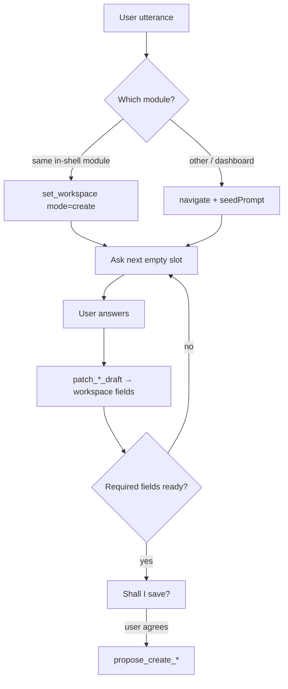

# Module chat: routing and one-by-one field collection

How coworker chat **routes to the right module**, then **asks for details one field at a time**, and how each answer lands in the workspace draft.

Pipeline (how a turn reaches the LLM) is in [`module-chat-intents.md`](./module-chat-intents.md). This file is the **questionnaire + routing** map.

Sources of truth:

| What | Where |
|---|---|
| Next question (chat) | `ai-service/app/agents/draft_conversation.py` (`next_*_prompt`, `contact_next_ask_key`, `*_draft_ready`) |
| LLM create instructions | `MODULE_ADDONS` in `ai-service/app/agents/crm_tools.py` |
| Workspace progress steps | `frontend/src/lib/coworker/guided-setup-steps.ts` |
| Module routing | `IN_SHELL_CREATE`, `resolve_cross_module_create`, `resolve_create_navigate` in `ai-service/app/agents/crm_agent.py` |

---

## How one-by-one collection works (all modules)

1. User starts create (or is already on create). Chat asks **one** missing slot.
2. User answers in chat. LLM calls `patch_*_draft` with the field(s). Shell merges `patch` into the form. The step list on the right marks that slot **completed**.
3. Chat asks the **next** empty slot (`sessionMemory.pendingAsk`).
4. If the user **volunteers several fields in one message** (“Priya Sharma, priya@acme.com”), all of them are patched; chat only asks what is still missing.
5. Optional slots can be **skipped**. Skipped keys are stored (`skippedOptional`) and **never re-asked**.
6. When required slots are filled (`*_draft_ready`), chat recaps and asks to save. User agrees → `propose_create_*` → Fastify form submit.

Chat never tells the user to click the form, type “skip”, or “say yes”. Save is a natural “Shall I save them?”

---

## Module routing

In-shell create modules: **contact**, **company**, **sales** (deals), **product**, **quotes**, **finance** (invoices), **activities**.

| User is on | User says | Tool | Where create opens |
|---|---|---|---|
| Same module list (e.g. Contacts) | “create a contact” | `set_workspace` `{ mode: "create" }` | Create draft **in this page** |
| Same module already on create | “create a contact” | none (stay) | Chat continues the next question |
| Other in-shell module (e.g. Sales) | “create a contact” | `navigate` to `/contact/new` + `seedPrompt` | Contacts create; original utterance is auto-sent |
| Dashboard / inbox / reports / agents / … | “create a contact” | `navigate` only (never `set_workspace`) | Target module create |

Create-target keywords (`_explicit_create_target`):

| User mentions | Target `module` | First question after open |
|---|---|---|
| contact, lead, person, people | `contact` | “Sure! What's their full name?” |
| company, companies, account, organization, org | `company` | “Sure thing — what's the company name?” |
| deal, opportunity, pipeline | `sales` | “Happy to. What should we call this deal?” |
| quote, quotation | `quotes` | “Sure — which deal is this quote for?” |
| product, sku, catalog | `product` | “Let's add it. What's the product called?” |
| invoice, bill | `finance` | “Which deal should this invoice go with?” |
| activity, call, meeting, task, note, appointment, demo, schedule, calendar | `activities` | “Happy to log it. Who is this about?” |

**Proposal** is not a quote: “create a proposal” from Quotes navigates to **Sales** (`/sales`) with the utterance as `seedPrompt`.

**Finance** is not available for B2C (module gating). Chat should not open invoice create there.

**Company detail** “add a location / branch / HQ” stays on the company: `patch_location_draft`, not a new company.

---

## Shared rules while filling

- Speech never names tools, MCP, or “workspace”.
- Field-only language without “new / create / log” means **update an existing record**, not create.
- Catalog picks (company, deal, product, contact) match by **name**; IDs stay out of chat.
- Typed company name on a contact is accepted as `companyName` even if it is not in the catalog.

---

## 1. Contacts (`module=contact`)

**Patch:** `patch_contact_draft`  
**Save:** `propose_create_contact`  
**Ready:** first name + last name + (**email or phone**)

### Chat order (authoritative `contact_next_ask_key`)

| # | Slot | Required? | What chat asks | Draft keys patched |
|---|---|---|---|---|
| 1 | Name | **Yes** | Full name. One token → first name only, then last name next. “Priya Sharma” patches both. | `firstName`, `lastName` |
| 2 | Last name | **Yes** if missing | Only if they gave a single name token | `lastName` |
| 3 | Email | **One of email/phone required** | Prefer email first | `email` |
| 4 | Phone | Same as above | Asked if no email; optional if email already set (user may skip) | `phone` |
| 5 | Company | Optional | “Are they with a company, or shall I save?” | `companyName` and/or `companyId` |
| 6 | Title | Optional | “Any job title…?” | `title` |
| 7 | Save | — | Recap name + email/phone: “Shall I save them?” | `propose_create_contact` |

Phone should include country code when collected (e.g. `919876543210`).

### Extra fields (accepted if volunteered; shown on the panel)

Not in the default next-ask after title, but patched when the user offers them or the LLM walks remaining form fields: `city`, `country`, `leadSource`, `notes`, `lifecycleStage`, `leadStatus`, `locationId`. Skip keys: `phone`, `email`, `company`, `title`, `city`, `country`, `leadSource`.

### Turn-by-turn example

| Turn | User | LLM / tools | Workspace |
|---|---|---|---|
| 1 | “I want to create a contact” | `set_workspace` create; ask full name | Empty contact draft |
| 2 | “Priya Sharma” | `patch_contact_draft` firstName+lastName; ask email | First / last filled |
| 3 | “priya@acme.com” | patch `email`; ask phone (optional) or company | Email filled |
| 4 | “skip” (phone) | `skippedOptional` includes `phone`; ask company | Phone marked skipped |
| 5 | “Acme” | patch `companyName`; ask title | Company filled |
| 6 | “yes, save” (after ready) | `propose_create_contact` auto | Contact created; list refresh |

CSV bulk import is a **separate** path (`propose_import_contacts`) — not one-by-one create.

---

## 2. Companies (`module=company`)

**Patch:** `patch_company_draft`  
**Save:** `propose_create_company`  
**Ready:** `name` + `locationName`

### Chat order (`next_company_prompt`)

| # | Slot | Required? | What chat asks | Draft keys |
|---|---|---|---|---|
| 1 | Company name | **Yes** | “What's the company called?” | `name` |
| 2 | First location | **Yes** | City or office name (e.g. “Mumbai HQ”) | `locationName` |
| 3 | Domain / industry | Optional | Can ask together, then the missing one | `domain`, `industry` |
| 4 | Save | — | Recap and offer to save | `propose_create_company` |

### Extra fields (volunteered or later questions)

`locationAddress`, `locationType` (`hq` \| `branch`), `employeeCount`, `linkedinUrl`, owner / channel / parent company (update tools). Address is asked only **after** location name exists.

### Location on company detail (`patch_location_draft`)

| # | Slot | Required? | Draft keys |
|---|---|---|---|
| 1 | Location name | **Yes** | `name` |
| 2 | Type | Optional | `type` (`hq` / `branch`) |
| 3 | Address | Optional | `address` |
| 4 | Industry | Optional | `industry` |
| 5 | Save | — | create location on that company |

---

## 3. Sales / deals (`module=sales`)

**Patch:** `patch_deal_draft`  
**Save:** `propose_create_deal`  
**Ready:** `title` + (`companyId` or `companyName`)

### Chat order (`next_deal_prompt`)

| # | Slot | Required? | What chat asks | Draft keys |
|---|---|---|---|---|
| 1 | Deal title | **Yes** | “What should we call this deal?” | `title` |
| 2 | Company | **Yes** | Pick from list or type a new name | `companyId` / `companyName` |
| 3 | Save | — | Recap title + company | `propose_create_deal` |

### Extra fields (LLM walks these one at a time if still empty)

`locationId`, `contactId` / `contactName`, `amount`, `currency`, `stage`, `expectedCloseDate`, `notes`.

### Proposals (deal documents, not quotes)

On Sales: resolve deal (and product if needed) → `propose_create_proposal` (`dealId`, optional `productIds` / `productHint` / `title`). Do not open a new deal if `knownDeals` already matches. Detail: rewrite / personalize / send / delete proposal tools.

---

## 4. Products (`module=product`)

**Patch:** `patch_product_draft`  
**Save:** `propose_create_product`  
**Ready:** `name` + `sku`

### Chat order (`next_product_prompt` + product addon)

Same `inventory.products` table for every motion. **Which slots chat asks** follows `businessType`:

| Slot | Required? | B2B | B2C | B2B2C | Draft keys |
|---|---|---|---|---|---|
| 1 Name | **Yes** | ✓ | ✓ | ✓ | `name` |
| 2 SKU | **Yes** | ✓ | ✓ | ✓ | `sku` |
| 3 Price | Optional | ✓ | ✓ | ✓ | `price` |
| 4 Currency | Optional | ✓ | ✓ | ✓ | `currency` |
| 5 Product type | Optional | ✓ | — | ✓ | `productType` |
| 6 Billing | Optional | ✓ | — | ✓ | `billingType`, `billingFrequency` |
| 7 Max discount % | Optional | ✓ | — | ✓ | `maxDiscountPercent` |
| 8 Brand | Optional | — | ✓ | ✓ | `brand` |
| 9 Stock on hand | Optional | — | ✓ | ✓ | `stockOnHand` |
| 10 Product URL | Optional | ✓ | ✓ | ✓ | `productUrl` |
| 11 Category / subcategory | Optional | ✓ | ✓ | ✓ | `category`, `subcategory` |
| 12 Description / tags / image | Optional | ✓ | ✓ | ✓ | `description`, `tags`, `imageUrl` |
| 13 Offers then addons | If customizable | ✓ | — | ✓ | `offers[]`, `addons[]` |
| 14 Save | — | recap name + SKU | same | same | `propose_create_product` |

B2C never walks quote/CPQ fields (type, billing, discount, offers). B2B never walks brand or stock. Category is shared catalog grouping, not commerce-only.

The **next-question fallback** (`next_product_prompt`) and the workspace step list share this order. Billing is only `one_time` / `recurring` — never per-seat. Volunteered fields are always patched immediately — then dropped if they are off-motion.

---

## 5. Quotes (`module=quotes`)

**Patch:** `patch_quote_draft`  
**Save:** `propose_create_quote`  
**Ready:** `dealId` + `productId` + `quantity`

### Chat order (`next_quote_prompt`)

| # | Slot | Required? | What chat asks | Draft keys |
|---|---|---|---|---|
| 1 | Deal | **Yes** | Name the deal; fuzzy-match `knownDeals` | `dealId` |
| 2 | Product / plan | **Yes** | Product (and offer if the product has plans) | `productId`, `offerId` |
| 3 | Quantity + discount | Quantity **required** to be ready | “How many units, and any discount?” | `quantity`, `discountPct` |
| 4 | Addons | If product is customizable | | `addonQuantities` |
| 5 | Save | — | Recap deal title + product | `propose_create_quote` |

Optional notes / customer / company / vendor names can be patched if volunteered. Speak **names only**, never IDs.

---

## 6. Finance / invoices (`module=finance`)

**Patch:** `patch_invoice_draft`  
**Save:** `propose_create_invoice`  
**Ready (agent):** `dealId`  
**Workspace steps also treat product as required** for a real line (deal + product).

### Chat order

| # | Slot | Required? | What chat asks | Draft keys |
|---|---|---|---|---|
| 1 | Deal | **Yes** | “Which deal should this invoice link to?” | `dealId` |
| 2 | Product + quantity | Needed for a real line (do not invent qty 1) | Match `knownProducts` | `productId`, `quantity`, `addonQuantities` |
| 3 | Dates | Optional | Issue / due | `issueDate`, `dueDate` |
| 4 | Currency / terms / notes | Optional | | `currency`, `paymentTerms`, `notes` |
| 5 | Save | — | Recap deal (+ product/qty if set) | `propose_create_invoice` |

`next_invoice_prompt` after a deal is linked offers save immediately (“Shall I create the invoice?”). The LLM addon still collects product, qty, dates, tax, discount, billing address when those are missing.

Detail page: send, mark paid, update lines/notes, delete — not a new draft.

---

## 7. Activities (`module=activities`)

**Patch:** `patch_activity_draft`  
**Save:** `propose_create_activity`  
**Ready:** `contactId` + `subject`

### Chat order (`next_activity_prompt`)

| # | Slot | Required? | What chat asks | Draft keys |
|---|---|---|---|---|
| 1 | Contact | **Yes** | “Who is this about?” — match by name | `contactId` |
| 2 | Subject | **Yes** | Short subject line | `subject` |
| 3 | Type | Optional | call / meeting / task / note / … | `type` |
| 4 | Due | Optional | When | `dueAt` |
| 5 | Notes | Optional | Body | `body` |
| 6 | Save | — | Recap contact + subject | `propose_create_activity` |

Chat asks contact, then subject, then save. Type / due / body are filled when volunteered or asked as extras.

---

## Nav-only modules (no create questionnaire)

These still have chat, but **no** in-shell create and **no** `set_workspace`:

`dashboard`, `inbox`, `reports`, `agents`, `commerce`, `service`, `configuration`, `marketing`, `process-approvals`

“Create a contact / deal / …” → `navigate` to that module’s create route with `seedPrompt`, then the target module runs the questionnaire above.

---

## Ready vs panel vs LLM extras

Three lists can differ slightly; they are meant to stay aligned:

| Layer | Role |
|---|---|
| `*_draft_ready` | When chat is allowed to offer **save** |
| `next_*_prompt` / `contact_next_ask_key` | Which **single question** is asked next |
| `guided-setup-steps.ts` | Right-pane progress (read-only mirror) |
| `MODULE_ADDONS` | Extra optional fields the LLM may walk after required slots |

If the user dumps the whole record in one message, every recognized field is patched in that turn and chat jumps to the first remaining gap (or save).

---

## File index

- Routing: `ai-service/app/agents/crm_agent.py` (`IN_SHELL_CREATE`, `resolve_cross_module_create`, `resolve_create_navigate`)
- Next question + ready: `ai-service/app/agents/draft_conversation.py`
- Contact skip / STM: `ai-service/app/agents/contact_draft_agent.py`
- Other drafts: `company_draft_agent.py`, `deal_draft_agent.py`, `misc_draft_agents.py`
- Prompts: `ai-service/app/agents/crm_tools.py` (`MODULE_ADDONS`)
- UI steps: `frontend/src/lib/coworker/guided-setup-steps.ts`
- Shell apply: `frontend/src/components/coworker/AgentModuleShell.tsx`
