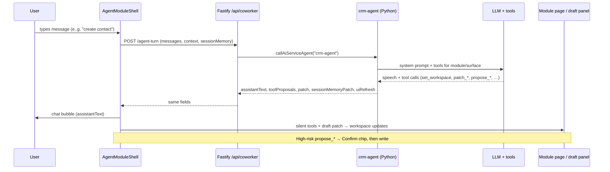

# Module chat: intents, LLM tools, and workspace sync

How coworker chat works end-to-end: user utterance → Fastify → Python `crm-agent` / LLM tools → UI chat + draft workspace.

Related:

- [`module-chat-field-collection.md`](./module-chat-field-collection.md) — per-module routing and one-by-one field questionnaires
- [`worktual-combine-contracts.md`](./worktual-combine-contracts.md) — MCP HTTP, `confirmTool`, `uiRefresh`, dual path (forms + agents)
- [`AGENTS.md`](../AGENTS.md) — LLM-mandatory agents, MCP on ai-service
- [`multi-tenancy-common-model.md`](./multi-tenancy-common-model.md) — business-type gating

---

## 1. Big picture



**Rules of thumb**

| Layer | Owns |
|---|---|
| Chat bubble | `assistantText` only (never mention tool names / MCP / `set_workspace`) |
| Workspace / form fields | `patch` / `contactDraftPatch` + `set_workspace` |
| Persist to CRM | `propose_*` → page form submit (form-owned) or MCP mutation |
| List/detail reload | `uiRefresh` after writes |

Manual create/edit forms stay first-class forever (dual path). Chat fills and proposes; forms still write through Fastify when form-owned.

---

## 2. Frontend entry

### Shell

| File | Role |
|---|---|
| `frontend/src/components/coworker/AgentModuleShell.tsx` | Sends turns, applies patches, runs tools |
| `frontend/src/services/coworker.ts` | `assistAgentTurn`, `confirmCoworkerTool`, STM merge |
| `frontend/src/components/coworker/CoworkerChatShell.tsx` | Chat chrome |
| `frontend/src/components/coworker/CoworkerWorkspace.tsx` | Right pane host |
| `frontend/src/lib/coworker/guided-setup-steps.ts` | Progress mirror of create slots (panel reads draft; chat asks) |

### Modules with in-shell create (`set_workspace`)

These use `AgentModuleShell` with `moduleId` and can open a create draft in the same page:

| `module` | Pages (examples) | Create draft panel |
|---|---|---|
| `contact` | `ContactsPage`, `ContactDetailPage`, `ContactFormPage` | `ContactCreateDraftPanel` |
| `company` | `CompaniesPage`, … | company draft |
| `sales` | `SalesPipelinePage`, `DealDetailPage`, … | deal draft |
| `product` | `ProductsPage`, … | product draft |
| `quotes` | `QuotesPage`, … | quote draft |
| `finance` | `FinancePage`, … | invoice draft (not B2C) |
| `activities` | `ActivitiesPage` | activity draft |

Nav-only modules (`dashboard`, `inbox`, `agents`, `commerce`, `service`, `configuration`, `marketing`, `process-approvals`) still chat via native tools, but **must not** call `set_workspace` — they `navigate` to an in-shell module instead. **`reports`** remains nav-only for **marketing** campaign sidebar only; all other roles get analytics embedded on **Dashboard** (`GET /api/home` → `analytics` block) with copilot `query_analytics` on `module=dashboard`.

### What the shell sends on every turn

```ts
assistAgentTurn({
  messages: [{ role: "user" | "assistant", text: string }, ...],
  context: {
    module,      // e.g. "contact"
    surface,     // "list" | "create" | "detail" | …
    entityId,    // open record id when on detail
    pathname,
    draft,       // current create-form fields (or null on list)
  },
  sessionMemory: {
    conversationId?,
    pendingIntent?,  // e.g. create_contact
    pendingAsk?,     // e.g. email | phone | save
    slots?,
    lastEntities?,
  },
});
```

`draft` is taken from a live ref so a same-turn patch is visible on the next utterance.

### What the shell does with the response

1. Append **`assistantText`** as the assistant bubble.
2. Merge **`sessionMemoryPatch`** into client STM.
3. Apply **`uiRefresh`** (optional `href` navigate + reload callbacks).
4. Split **`toolProposals`**:
   - **Silent** (`navigate`, `open_entity`, `set_workspace`, and auto/`confirmed` low-risk proposes) → `runTool` immediately.
   - **Confirm** (high-risk without auto) → chips in chat; user confirms → `runTool` / `confirmCoworkerTool`.
5. Apply **`patch` / `contactDraftPatch`** via `onDraftPatch` (form fields update; guided steps re-resolve).

---

## 3. Backend path

```
Vite AgentModuleShell
  → POST /api/coworker/agent-turn
  → agentTurnCommand()     backend/src/service/ai/coworker-agent-turn.ts
  → callAiServiceAgent("crm-agent")
  → POST {AI_SERVICE}/ai/v1/agents/crm-agent/run
  → crm_agent.run() / handle_agent_turn()
```

| Piece | Path |
|---|---|
| Routes | `backend/src/modules/coworker/routes.ts` (`/api/coworker`) |
| Turn command | `backend/src/service/ai/coworker-agent-turn.ts` |
| AI client | `backend/src/service/ai/ai-service-client.ts` |
| Python entry | `ai-service/app/api/routes.py` → `crm_agent` |

Fastify enriches **catalog** (role, business type, org, `currentDraft`, company/contact/deal options, durable memory) then calls Python with `intent: "agent_turn"`.

If ai-service is down, Fastify returns limited offline heuristics — never presented as full AI when the LLM path failed for content.

### Response fields (UI contract)

| Field | Effect in UI |
|---|---|
| `assistantText` | Chat bubble |
| `toolProposals[]` | `{ id, name, label, args, risk }` — silent run or Confirm |
| `patch` / `contactDraftPatch` | Merge into create draft form |
| `sessionMemoryPatch` | Client STM (`pendingAsk`, slots, …) |
| `uiRefresh` | Reload lists/detail; optional `href` |

---

## 4. Python agent routing

Orchestrator: `ai-service/app/agents/crm_agent.py` → `handle_agent_turn`.

Supporting layers:

| File | Role |
|---|---|
| `crm_tools.py` | `build_system_prompt`, `tools_for_module`, `run_native_agent_turn`, `map_tool_calls_to_result` |
| `coworker_runtime.py` | STM, `run_skill_turn`, proposal hooks, post-commit |
| `coworker_shared.py` | Speech sanitize, memory helpers |
| `draft_conversation.py` | Ready checks, next-ask keys, field parsers, confirm heuristics |
| `*_coworker_agent.py` | Module specialists (list/open/edit/delete) |
| `*_draft_agent.py` / `misc_draft_agents.py` | Create-surface fill (after / with native tools) |
| `mcp/catalog.py` | Sole tool schema source |
| `mcp/dispatch.py` | Execute tools (UI directive, draft patch, mutation, form_owned) |

### Typical order inside `handle_agent_turn`

1. Hydrate STM (`normalize_session_memory`).
2. Proposal / cross-module handoffs.
3. Deterministic routes when clear (show list, go-to module, same-module create → often emit `set_workspace` / `navigate`; speech from LLM when configured).
4. Open-record field updates (detail surfaces).
5. **Native LLM tools first** (`run_skill_turn` → `run_native_agent_turn`) when AI is configured.
6. Module specialist (`contact_coworker_agent`, …).
7. **Create surface**: native tools → then draft agent enrich / fallback.
8. Offline heuristics only if LLM unavailable.

`IN_SHELL_MODULES` = `contact`, `sales`, `company`, `product`, `finance`, `quotes`, `activities`.

---

## 5. How the LLM “notifies” the workspace

The model never talks to React directly. It **calls tools**. The mapper turns tool calls into response fields the shell already understands.

| Tool | Kind | UI effect |
|---|---|---|
| `set_workspace` | UI directive | Page `onWorkspaceCommand` → list / create / detail |
| `navigate` / `open_entity` | UI directive | Router navigate (optional `seedPrompt` → auto-send) |
| `patch_contact_draft` (and other `patch_*_draft`) | Draft patch | Collapsed into `patch` — form fields fill |
| `ask_clarification` | Clarify | Becomes / reinforces `assistantText` |
| `propose_create_*` / `propose_update_*` / … | Mutation or form-owned | Confirm or auto-run → write |
| MCP write success | — | Often accompanied by `uiRefresh` |

Important UX invariants (enforced in prompts / mappers):

- Speech must **not** mention tool names, routing, MCP, or “workspace”.
- Filling a field = `patch_*_draft` + natural question for the next slot.
- Saving = `propose_create_*` (usually with `auto: true` after user confirms and draft is ready).

### Form-owned vs MCP write

`FORM_OWNED_TOOLS` in `ai-service/app/mcp/catalog.py` includes creates for contact, company, deal, product, activity, plus many quote/invoice/proposal/contact mutations.

For those, MCP returns `kind: form_owned`. The shell / page `onToolConfirm` runs the **Fastify** create/update (e.g. contact form submit). Other tools may write `crm.*` via MCP dispatch when confirmed.

---

## 6. Walkthrough: create a contact

### Turn A — “I want to create a contact” (list)

**Context:** `module=contact`, `surface=list`, `draft=null`.

1. Router / native / specialist decides create intent.
2. Emits tool:
   ```json
   {
     "name": "set_workspace",
     "args": { "mode": "create", "auto": true },
     "risk": "low"
   }
   ```
3. `assistantText` asks for the name (natural language).
4. Shell runs `set_workspace` silently → `ContactsPage.onWorkspaceCommand` → URL/view `create`, empty draft, `ContactCreateDraftPanel` visible.
5. STM may set `pendingIntent=create_contact`, `pendingAsk=firstName` (or full name).

User sees: chat asks for name; right pane shows empty create form / guided steps.

### Turn B — “Priya Sharma” (create)

**Context:** `surface=create`, `draft={}` (or prior patches).

1. Native turn tools include `patch_contact_draft`.
2. LLM calls e.g. `patch_contact_draft({ "firstName": "Priya", "lastName": "Sharma" })`.
3. Mapper merges args into response `patch` / `contactDraftPatch`.
4. `enrich_contact_draft_result` / `contact_next_ask_key` sets next ask (`email` preferred when no reachability yet).
5. Shell `onDraftPatch` → form shows first/last; guided step for name completes; chat asks for email (or phone).

User sees: fields appear in the workspace without typing in the form; chat continues the questionnaire.

### Later turns — email / phone / company / title

Same pattern: each answer → `patch_contact_draft` → more fields in the panel. Optional fields can be skipped (`skippedOptional` in draft / STM).

**Ready rule** (`contact_draft_ready`): first name + last name + (**email or phone**).

### Turn C — “yes” / “save them”

1. `looks_like_create_confirm` + draft ready.
2. Emit `propose_create_contact` with args from draft and usually `auto: true`.
3. Shell runs tool → page `onToolConfirm` → draft panel submit → Fastify contact create.
4. Success speech; `onAfterTool` / `uiRefresh` reloads list; often return to list with highlight.

```mermaid
flowchart LR
  A["User: create contact"] --> B["set_workspace mode=create"]
  B --> C["Empty draft panel"]
  C --> D["User: Priya Sharma"]
  D --> E["patch_contact_draft"]
  E --> F["Form shows name"]
  F --> G["User: email / phone"]
  G --> H["More patches"]
  H --> I["User: yes"]
  I --> J["propose_create_contact"]
  J --> K["Fastify create + refresh"]
```



---

## 7. Per-module create matrix

| Module | Patch tool | Save tool | Ready-ish requirements | Notes |
|---|---|---|---|---|
| **contact** | `patch_contact_draft` | `propose_create_contact` | first + last + (email \| phone) | CSV: `propose_import_contacts`. Updates/deletes often form-owned via page mutations |
| **company** | `patch_company_draft` (+ `patch_location_draft` on detail) | `propose_create_company` | name + locationName | Location required before ready |
| **sales** | `patch_deal_draft` | `propose_create_deal` | title + company | Stage: `propose_stage_change`. Proposals: `propose_create_proposal` |
| **product** | `patch_product_draft` | `propose_create_product` | name (+ SKU enforced in UI errors) | |
| **quotes** | `patch_quote_draft` | `propose_create_quote` | deal + product | Catalog fuzzy match; proposal create redirects to sales |
| **finance** | `patch_invoice_draft` | `propose_create_invoice` | dealId | B2C must not enable finance |
| **activities** | `patch_activity_draft` | `propose_create_activity` | contact + subject | |

Guided step order for the panel progress mirror lives in `frontend/src/lib/coworker/guided-setup-steps.ts` and should stay aligned with `draft_conversation` / draft agents’ next-ask order.

### Non-create intents (same chat)

Examples on contact (specialist + tools):

| User intent | Typical tools / behavior |
|---|---|
| Show / search list | Filter UI / speech; stay on list |
| Open a person | `set_workspace` `mode=detail` + `entityId`, or `open_entity` |
| Edit fields | `propose_update_contact` (confirm) |
| Delete | `propose_delete_contact` (high-risk confirm) |
| Merge | `propose_merge_contacts` |
| Go to another module | `navigate` (and create there if asked) |

Similar patterns exist for company / deal / product / quote / invoice specialists.

---

## 8. Session memory (STM)

Client holds short-term memory between turns; server returns patches.

| Slot | Meaning |
|---|---|
| `pendingIntent` | What we’re doing (`create_contact`, …) |
| `pendingAsk` | Next field key (`firstName`, `email`, `save`, …) |
| `slots` | Scratch values / hints |
| `lastEntities` | Last mentioned contact/deal/company ids |
| `conversationId` | Continuity id |

Durable prefs also hydrate from `crm.agent_memories` into catalog (`durableMemory`) — see combine contracts.

---

## 9. Confirm flow (high-risk)

1. Agent returns `toolProposals` with `risk: "high"` (and not auto).
2. Shell shows Confirm / Cancel chips under the bubble.
3. Confirm → `confirmCoworkerTool` → same `POST /agent-turn` with `confirmTool: { name, args }`.
4. Python `crm_agent.run` short-circuits to MCP with `confirmed=true`.
5. On success: speech + `uiRefresh`; form-owned tools still execute via page handlers when MCP reports form-owned.

---

## 10. Legacy parallel path

Still registered for hybrid create routes (`/contact/new`, `/company/new`, …):

- UI: `CoworkerCreateShell` + `*CreateCoworkerPage`
- API: `POST /api/coworker/contact-draft`, `company-draft`, `deal-draft`, … (not `agent-turn`)
- Python intents: `contact_draft`, `deal_draft`, …

Preferred UX for list pages is **in-shell**: `set_workspace mode=create` on the module page so chat never leaves the module shell.

`POST /api/coworker/page-assist` is the older page-rail assist path.

---

## 11. File index (quick)

**Frontend:** `AgentModuleShell`, `assistAgentTurn`, `confirmCoworkerTool`, `mergeSessionMemoryPatch`, page `onWorkspaceCommand` / `onDraftPatch` / `onToolConfirm`, draft panels, `guided-setup-steps.ts`, `lib/coworker/contact-mutations.ts`

**Backend:** `coworker/routes.ts`, `coworker-agent-turn.ts` (`agentTurnCommand`, catalog enrich, offline fallback)

**Python:** `crm_agent.handle_agent_turn`, `run_native_agent_turn`, `map_tool_calls_to_result`, `draft_conversation` (`contact_draft_ready`, `contact_next_ask_key`, `looks_like_create_confirm`), module `*_coworker_agent` / `*_draft_agent`, MCP `catalog` + `dispatch`

**Tests as living docs:** `ai-service/tests/test_conversational_crud.py`, `test_contact_coworker.py`, `test_contact_field_matrix.py`, `test_company_field_matrix.py`, `test_deal_field_matrix.py`, `test_product_field_matrix.py`, `test_finance_field_matrix.py`, `test_quote_field_matrix.py`, `test_activity_field_matrix.py`, `test_proposal_field_matrix.py`, `test_pricebook_field_matrix.py`, `test_module_draft_workspace.py`, `backend/scripts/e2e-contact-chat-flows.ts`, `e2e-contact-field-matrix.ts`, `e2e-company-field-matrix.ts`, `e2e-deal-field-matrix.ts`, `e2e-product-field-matrix.ts`, `e2e-finance-field-matrix.ts`, `e2e-quote-field-matrix.ts`, `e2e-activity-field-matrix.ts`, `e2e-proposal-field-matrix.ts`, `e2e-pricebook-field-matrix.ts`, `e2e-b2b-revenue-flow-field-matrix.ts`, `e2e-configuration-templates-field-matrix.ts`, `e2e-calendar-field-matrix.ts`, `e2e-finance-contracts-field-matrix.ts`, `e2e-proposal-patterns-field-matrix.ts`, `e2e-dashboard-inbox-marketing-notifications.ts`, `e2e-proactive-agents.ts`

**B2B-only extensions (not in §7 in-shell create list):** price books, document templates (quote/proposal/invoice), revenue path quote→order→invoice, proposals API + detail tools, calendar schedule, finance contracts read APIs, **proposal patterns / corpus** (`e2e-proposal-patterns-field-matrix.ts`; optional `RUN_PROPOSAL_CORPUS_PAIR_SCORE_E2E=1`, `RUN_PROPOSAL_CORPUS_JOB_E2E=1`). Skip **commerce** for pure B2B. Optional: `RUN_*_LLM_E2E=1` chat layers; email OAuth configuration.

---

## 12. Mental model (one sentence)

User speech goes to **`crm-agent`**, which answers with **chat text** and **tools**; the shell turns tools into **workspace mode**, **draft field patches**, and **confirmed writes**, so saying a first name updates the create form without the user touching the inputs.
