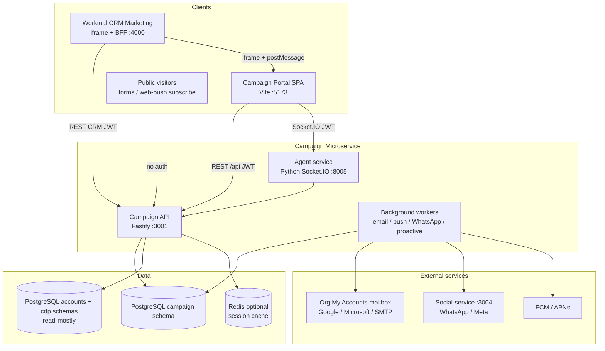

# Worktual Campaign Microservice — Architecture Overview

Document for cross-team sharing (CRM, Accounts, Social, Ops, Platform).

**Product:** Multi-channel marketing campaigns (email, SMS, WhatsApp, push, web push, forms).  
**Deployment model:** Standalone microservice — own UI, API, agent service, and `campaign` DB schema.  
**Shared platform:** Reads identity, org, and contacts from Worktual Accounts + CDP (no DDL on those schemas).

**Agent runtime (prompts, workflows, migration):** [`campaign-agent-runtime/README.md`](./campaign-agent-runtime/README.md)

---

## 1. Service topology



---

## 2. Runnables (what to start)

| Component | Stack | Default port | Health / docs |
|-----------|--------|--------------|---------------|
| **Campaign API** | Node 20, Fastify 5, TypeScript, Prisma | **3001** | `GET /health`, `GET /docs` (Swagger) |
| **Campaign Portal (SPA)** | React 19, Vite, Redux Toolkit | **5173** | UI only; proxies `/api` → `:3001` in dev |
| **Agent service** | Python, native tool loop, Socket.IO | **8005** | `GET /health` |

From repo root (`worktual-campaign/`):

```bash
npm run dev:backend    # API :3001
npm run dev:frontend   # SPA :5173
npm run dev:agents     # Agents :8005 (separate venv — see agents/README.md)
```

**Typical LAN URLs (example host):**

| Surface | URL |
|---------|-----|
| Portal | `http://192.168.11.31:5173` |
| API | `http://192.168.11.31:3001/api` |
| Swagger | `http://192.168.11.31:3001/docs` |
| CRM iframe embed | `http://192.168.11.31:5173/dashboard?embed=1` |

---

## 3. Monorepo layout

```
worktual-campaign/
├── frontend/          # Campaign Portal SPA (new UI — Vite)
├── backend/           # Campaign API + workers
├── agents/            # AI agent service (create campaign, templates, monitoring)
├── docs/              # Operator & integration docs
└── _legacy_next/      # Archived Next.js UI — NOT used in production
```

| Path | Role |
|------|------|
| `backend/src/server.ts` | HTTP route registration, CORS, JWT plugin |
| `backend/src/modules/*` | Feature modules (auth, campaigns, contacts, config, …) |
| `backend/src/dao/*` | Data access (Prisma for `campaign`, `pg` pool for Accounts/CDP) |
| `backend/src/services/*` | Workers, ESP, push providers, personalization |
| `backend/prisma/schema.prisma` | Campaign schema source of truth |
| `frontend/src/routes/AppRouter.tsx` | SPA routing |
| `frontend/src/services/api.ts` | Axios client + JWT attachment |

---

## 4. Data architecture

### 4.1 Two-database pattern (same Postgres cluster, different schemas)

| Connection | Env var | Schemas | Campaign writes? |
|------------|---------|---------|------------------|
| **Campaign owned** | `DATABASE_URL` | `campaign` | **Yes** — campaigns, sends, templates, config, entitlements |
| **Platform shared** | `ACCOUNT_DATABASE_URL` | `accounts`, `cdp` | **Read-only** for users/orgs; **limited CRUD** on existing CDP contact columns |

**Tenant model:** `tenant_id` = `accounts.setup_users.organization_id` (resolved at login; never taken from request body).

**External IDs in campaign DB:** User ids and contact ids reference Accounts/CDP but are **not duplicated** as full user/contact tables inside `campaign`.

See: [docs/schema/campaign_er_diagram.md](schema/campaign_er_diagram.md)

### 4.2 Campaign lifecycle (data flow)

1. **Draft** — `campaign_agent_sessions` + audience refs + channel templates (AI-assisted)
2. **Save / launch** — `campaigns`, `campaign_channels`, `campaign_audience`
3. **Send** — `campaign_send_batches` → `campaign_send_recipients`
4. **Engagement** — open/click tracking, suppressions, notifications

### 4.3 Entitlements

Product access: `campaign.organization_products` where `product_code = 'campaign'`.

- **SPA login path:** may auto-provision branch + product for demo/dev flows
- **CRM JWT path:** requires `setup_user_product_access.product_id = crm`, active user, and existing org Campaign entitlement — **403** if missing (no auto-create)

---

## 5. Authentication

### 5.1 Campaign Portal (standalone)

| Step | Detail |
|------|--------|
| Login | `POST /api/auth/login` — email/password against `accounts.setup_users` |
| Token | Campaign JWT signed with `JWT_SECRET` (7d / 30d) |
| Storage | Browser `localStorage` key `worktual.campaign.jwt` |
| Session | `GET /api/auth/me` reloads user from Accounts on each request |

### 5.2 CRM integration (Path A)

CRM mints its own access JWT; Campaign verifies separately from SPA secret.

| Setting | Value |
|---------|--------|
| Env | `CRM_JWT_ACCESS_SECRET`, `CRM_JWT_ISSUER=worktual-crm`, `CRM_JWT_USER_ID_CLAIM=sub` |
| Algorithm | HS256, ~900s TTL (CRM-side) |
| API | `Authorization: Bearer <CRM JWT>` on `/api/*` (SPA JWT tried first) |
| Portal embed | iframe + `postMessage` `{ type: "worktual:campaign-auth", token }` |

Full CRM integration: [CRM_CAMPAIGN_INTEGRATION.md](CRM_CAMPAIGN_INTEGRATION.md) · API handoff: [CRM_CAMPAIGN_HANDOFF.md](CRM_CAMPAIGN_HANDOFF.md)

### 5.3 Agent service

Socket.IO connects to `:8005` with Campaign JWT in handshake `auth.token` (same as SPA).

---

## 6. API surface (`/api`)

All routes prefixed with `/api` unless noted.

| Module | Prefix | Purpose |
|--------|--------|---------|
| Auth | `/auth` | Login, me, logout |
| Campaigns | `/campaigns` | CRUD, dashboard, launch, tracking pixels (public) |
| Contacts | `/contacts` | Audience — backed by CDP |
| Agent sessions | `/agent-sessions` | AI draft persistence |
| Channel templates | `/channel-templates` | Per-channel draft content |
| Configuration | `/configuration` | Email domain/senders, push, SMS |
| Templates | `/templates` | Template library |
| Notifications | `/notifications` | In-app notification feed |
| Industry pack | `/industry-pack` | Org-specific field/rules |
| Media | `/media` | Image upload |
| Web push (staff) | `/web-push` | Staff push config tests |
| Web push (public) | `/public/web-push` | Visitor subscribe — no JWT |
| Public forms | `/public/forms` | Published forms — view/submit public; publish requires JWT |
| App push | `/app-push` | Mobile push registration |
| Email/SMS stubs | `/email-campaign`, `/sms-campaign` | Structure placeholders |

**Public (no auth):** email open/click pixels, web-push visitor endpoints, public form view/submit, email sender confirm link.

**Interactive API docs:** `/docs` (Swagger UI on the API host).

---

## 7. Background workers (inside Campaign API process)

Started from `backend/src/index.ts` alongside the HTTP server:

| Worker | Interval | Role |
|--------|----------|------|
| Email send | ~15s | Org My Accounts mailbox (Gmail / Graph / SMTP) |
| Push send | ~15s | FCM / APNs / web push |
| WhatsApp send | ~15s | Via social-service |
| WhatsApp status | ~60s | Poll Meta template approval |
| Proactive agent | ~10min | Send-time insights, template compliance |

---

## 8. External integrations

| System | Protocol | Purpose |
|--------|----------|---------|
| **Worktual Accounts** | PostgreSQL read | Users, orgs, roles, product access, campaign email mailbox |
| **CDP** | PostgreSQL read/write (existing columns) | Contact profiles, audience |
| **Worktual CRM** | REST + iframe | Marketing embed, campaign API from CRM session |
| **Social-service** | HTTP + `INTERNAL_SERVICE_KEY` | WhatsApp template submit/status/send |
| **Redis** | TCP (optional) | Session cache; falls back to in-memory |

Key env vars: see `backend/.env.example` (`SOCIAL_SERVICE_BASE_URL`, `INTERNAL_SERVICE_KEY`, `ACCOUNTS_API_BASE_URL`, etc.).

---

## 9. AI agent service

Separate Python process — **not** embedded in the Node API.

- **Transport:** Socket.IO (`/socket.io`)
- **Agents:** create-campaign orchestrator, per-channel template agents (email, SMS, WhatsApp, push, web), monitoring
- **Persistence:** Agent state saved via Campaign API (`/api/agent-sessions`, `/api/channel-templates`)
- **Industry packs:** Loaded from `agents/app/industry_packs/` (B2B/B2C context)

See: [agents/README.md](../agents/README.md)

---

## 10. Multi-channel sending

| Channel | Config module | Send path |
|---------|---------------|-----------|
| Email | `/api/configuration/email` | Email worker → org My Accounts mailbox |
| Push (app) | `/api/configuration/push/:channel` | Push worker → FCM/APNs |
| Web push | `/api/public/web-push` + staff config | Push worker |
| WhatsApp | Social-service channel config | WhatsApp worker + status poller |
| SMS | `/api/configuration/sms` | Stub / future |

Email operator guide: [EMAIL_CONFIGURATION.md](EMAIL_CONFIGURATION.md)

---

## 11. Boundaries for other teams

### What Campaign owns

- `campaign` schema (migrations in `backend/prisma/migrations/`)
- Campaign API, Portal UI, agent service
- Send orchestration, templates, engagement metrics
- Product entitlement rows for `product_code = campaign`

### What Campaign does **not** own

- Accounts user passwords, org provisioning (Accounts team)
- CRM session / CRM JWT minting (CRM team — Campaign only verifies)
- Meta/WhatsApp channel credentials (Social-service)
- Mail transport (org Google / Microsoft / SMTP mailbox in My Accounts)

### Integration contracts

| Team | Integration | Doc |
|------|-------------|-----|
| CRM | Path A JWT + Portal iframe | [CRM_CAMPAIGN_INTEGRATION.md](CRM_CAMPAIGN_INTEGRATION.md), [CRM_CAMPAIGN_HANDOFF.md](CRM_CAMPAIGN_HANDOFF.md) |
| Accounts | Shared DB `accounts.setup_users`, `organizations` | This doc §4 |
| Social | WhatsApp API proxy | `INTERNAL_SERVICE_KEY`, `SOCIAL_SERVICE_BASE_URL` |
| Ops | DKIM / Postfix | [EMAIL_OPENDKIM_HANDOFF.md](EMAIL_OPENDKIM_HANDOFF.md) |

### Rules other teams should respect

- Do **not** require Campaign to store or replay user passwords (CRM uses JWT).
- Do **not** ALTER/CREATE/DROP on `accounts` or `cdp` from Campaign migrations.
- `tenant_id` always comes from the authenticated user's org — never from client body.
- CRM users must exist in the **same** Accounts DB Campaign reads (`ACCOUNT_DATABASE_URL`).

---

## 12. Deployment checklist

```bash
# 1. Install
npm install

# 2. Configure
cp backend/.env.example backend/.env
# Set DATABASE_URL, ACCOUNT_DATABASE_URL, JWT_SECRET, CRM_JWT_* (if CRM)

# 3. Database
npm run db:deploy --workspace=backend
npm run db:seed --workspace=backend   # optional dev seed

# 4. Build (production)
npm run build

# 5. Run
npm run dev:backend    # or node backend/dist/index.js
npm run dev:frontend   # or serve frontend/dist behind nginx
npm run dev:agents     # Python venv
```

**Production notes:**

- Serve SPA static files with `frame-ancestors` allowing CRM origins (see `frontend/vite.config.ts`).
- Set `API_PUBLIC_URL` for email tracking pixels (must be internet-reachable).
- Redis recommended for multi-instance API.

---

## 13. Observability

| Signal | Location |
|--------|----------|
| API logs | Fastify structured logs (stdout) |
| Health | `GET /health` → `{ service: "campaign-backend" }` |
| Swagger | `GET /docs` |
| Worker activity | Log lines on startup: `Email send worker started`, etc. |

---

## 14. Related documentation

| Document | Audience |
|----------|----------|
| [README.md](../README.md) | Developers — quick start |
| [CRM_CAMPAIGN_INTEGRATION.md](CRM_CAMPAIGN_INTEGRATION.md) | CRM + Campaign — how we connect |
| [CRM_CAMPAIGN_HANDOFF.md](CRM_CAMPAIGN_HANDOFF.md) | CRM team — API curl & checklist |
| [EMAIL_CONFIGURATION.md](EMAIL_CONFIGURATION.md) | Marketing ops / email setup |
| [EMAIL_OPENDKIM_HANDOFF.md](EMAIL_OPENDKIM_HANDOFF.md) | Mail infra ops |
| [schema/campaign_er_diagram.md](schema/campaign_er_diagram.md) | DB / data team |

---

## 15. Version & stack summary

| Layer | Technology |
|-------|------------|
| Frontend | React, TypeScript, Vite, Redux Toolkit, React Router, Tailwind, Socket.IO client |
| API | Node.js, Fastify, `@fastify/jwt`, Prisma, `pg`, Zod |
| Agents | Python, native tool loop, Socket.IO, OpenAI-compatible LLM |
| Database | PostgreSQL 14+ |
| Cache | Redis (optional) |

**Service name in health check:** `campaign-backend`  
**API version path:** `/api` (no version segment in URL today; constant `APP_VERSION=v1` reserved)
