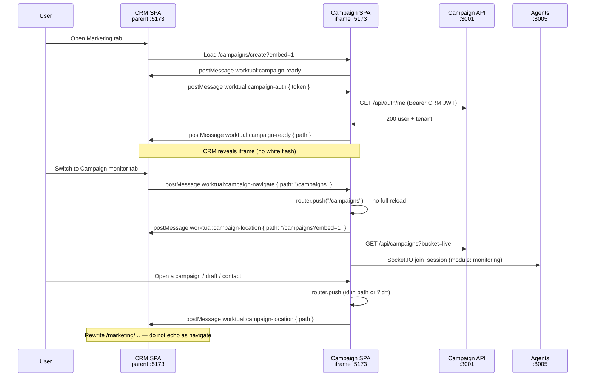

# How Worktual CRM connects to Campaign

This document describes the **end-to-end integration** between **Worktual CRM** (parent app) and the **Campaign microservice** (embedded UI + API). It is the canonical reference for both teams.

For API curl examples and deployment checklists, see also [CRM_CAMPAIGN_HANDOFF.md](CRM_CAMPAIGN_HANDOFF.md).

---

## 1. What we built

CRM Marketing embeds the Campaign portal inside an **iframe** and authenticates the user with the **same CRM access JWT** used for CRM API calls. Campaign verifies that JWT independently — there is **no password exchange** and **no token-swap endpoint**.

| Layer | How they connect |
|-------|------------------|
| **UI** | CRM iframes Campaign SPA (`:5173`) with `?embed=1` |
| **Auth handoff** | `postMessage` — CRM sends JWT, Campaign stores it in iframe `sessionStorage` |
| **REST API** | Campaign API (`:3001/api`) accepts `Authorization: Bearer <CRM JWT>` |
| **Monitor/agent** | `POST /api/campaigns/personalised-crm/automation` with `X-Crm-Integration-Key` + `organization_id` (no user login) |
| **AI co-worker** | Agents service (`:8005`) accepts the same CRM JWT on Socket.IO |
| **Identity** | JWT `sub` → `accounts.setup_users.id` (shared Accounts DB) |

Standalone Campaign login (email/password → Campaign JWT) is **unchanged** and does not affect CRM embed.

---

## 2. Service topology



**Typical LAN hosts (example):**

| System | Host | Port |
|--------|------|------|
| CRM parent | `192.168.13.126` or `localhost` | 5173 |
| Campaign UI (iframe) | `192.168.11.31` | 5173 |
| Campaign API | `192.168.11.31` | 3001 |
| Agents (WebSocket) | `192.168.11.31` | 8005 |

---

## 3. Two connection paths

### Path A — REST API (CRM BFF or direct)

CRM (or its backend) calls Campaign API with the logged-in user's CRM access JWT:

```http
GET /api/campaigns?bucket=all
Authorization: Bearer <CRM_ACCESS_JWT>
```

Campaign auth middleware:

1. Try **Campaign SPA JWT** (`JWT_SECRET`) — for standalone portal users
2. If that fails, verify **CRM JWT** (`CRM_JWT_ACCESS_SECRET`)
3. Load user from `accounts.setup_users` using claim `sub`
4. Resolve `tenantId` from user's `organization_id` (never from request body)
5. Check org **Campaign product entitlement** → **403** if missing (no auto-provision for CRM path)
6. Do **not** block by CRM role (admin vs marketing vs sales_rep)
7. Do **not** require per-user `product_id = campaign` row — only org entitlement + user `product_id = crm`

### Path B — iframe embed (Marketing UI)

CRM loads Campaign routes in an iframe and passes the JWT via `postMessage`:

```
http://192.168.11.31:5173/campaigns/create?embed=1
http://192.168.11.31:5173/campaigns?embed=1
http://192.168.11.31:5173/events?embed=1
```

With `embed=1`, Campaign hides its own sidebar and header so CRM chrome remains visible.

---

## 4. postMessage protocol

All messages use typed strings. Origins are validated against an allowlist on both sides.

| Direction | Type | Payload | When |
|-----------|------|---------|------|
| Campaign → CRM | `worktual:campaign-ready` | `{ path: "/campaigns/create/{draftId}?embed=1" }` | After auth succeeds **and** page content is painted (not during skeleton). `path` is **pathname + search** (`embed=1`, `tab`, `id`). Do not use this as a navigate echo. |
| Campaign → CRM | `worktual:campaign-location` | `{ path: "/campaigns?tab=live&id=1035&embed=1" }` | After every iframe route/search change (deduped). CRM should rewrite the parent address bar. **Never** post this back as `worktual:campaign-navigate`. |
| CRM → Campaign | `worktual:campaign-auth` | `{ token: "<CRM_ACCESS_JWT>" }` | On iframe load + every ~8 min (JWT refresh) |
| CRM → Campaign | `worktual:campaign-navigate` | `{ path: "/campaigns?embed=1" }` | Marketing **tab switch** only — client-side route, no iframe reload. Keep draft/campaign/contact ids when the CRM URL already has them. |

### CRM reveal handshake (no white flash)

1. CRM keeps iframe **hidden** until first `worktual:campaign-ready`.
2. Campaign bootstraps auth silently (blank `#f3f4f6`, not login/skeleton).
3. Each route calls `useEmbedPageReady(true)` when real content is visible.
4. `CampaignEmbedBridge` posts READY after paint (`requestAnimationFrame` × 2) and `worktual:campaign-location` on path/search changes.

### Parent URL / deep links (CRM address bar)

Campaign already puts ids in the **iframe** URL. CRM chrome stays `/marketing/create` unless CRM listens for location.

| Campaign iframe `path` | Keep this id in CRM |
|------------------------|---------------------|
| `/campaigns/create/{draftId}?embed=1` | `/marketing/create/{draftId}` (or equivalent) |
| `/campaigns?tab=…&id={campaignId}&embed=1` | `/marketing/campaigns?tab=…&id=…` |
| `/audience/{contactId}?embed=1` | `/marketing/audience/{contactId}` (or `/marketing/customers/…`) |

Rules:

1. Listen for `worktual:campaign-location` (READY `path` is also the full path; location is what updates when only `?id=` changes).
2. Map Campaign path → CRM Marketing path **without stripping** the draft/campaign/contact id.
3. When CRM → iframe, if the CRM URL is `/marketing/create/{id}`, the iframe `src` / navigate path must be `/campaigns/create/{id}?embed=1`, not bare `/campaigns/create`.
4. **Do not** echo `worktual:campaign-location` as `worktual:campaign-navigate` (loop / id wipe). Navigate is tab switches only.
5. Tokens (`crm_token`, `token`) are stripped from `path` before Campaign posts; `embed=1` is always present.

### Token refresh

- Campaign listens for `worktual:campaign-auth` for the **lifetime** of the iframe session.
- Each message **overwrites** `sessionStorage` key `worktual.campaign.embed-jwt`.
- On API **401**, Campaign clears the token, sends READY again, waits for fresh JWT, retries once.
- Duplicate auth with the **same token** does **not** re-bootstrap (avoids blank iframe).

### Fallback: query param (dev only)

```
/campaigns/create?embed=1&crm_token=<JWT>
```

Campaign strips `crm_token` from the URL immediately. Prefer `postMessage` in production.

---

## 5. JWT contract

CRM and Campaign must agree on these values.

| Item | CRM (issuer) | Campaign (verifier) |
|------|--------------|---------------------|
| Signing secret | `JWT_ACCESS_SECRET` | `CRM_JWT_ACCESS_SECRET` (**must match**) |
| Issuer (`iss`) | `worktual-crm` | `CRM_JWT_ISSUER=worktual-crm` |
| User id claim | `sub` = `accounts.setup_users.id` | `CRM_JWT_USER_ID_CLAIM=sub` |
| Algorithm | HS256 | `CRM_JWT_ALGORITHM=HS256` |
| TTL | ~900s (15 min) | CRM refreshes ~every 8 min |

**Important:** `sub` is **`accounts.setup_users.id`** (e.g. `"1005"`), not `crm.users.id`.

Example test user: `manojnlp04@gmail.com` → `sub=1005`.

---

## 6. Configuration

### Campaign backend (`backend/.env`)

```bash
CRM_JWT_ACCESS_SECRET="<same as CRM JWT_ACCESS_SECRET>"
CRM_JWT_ISSUER="worktual-crm"
CRM_JWT_USER_ID_CLAIM="sub"
CRM_JWT_ALGORITHM="HS256"
```

Restart API after changes.

### Campaign agents (`agents/.env`)

Agents must use the **same** CRM JWT settings for Socket.IO co-worker chat:

```bash
CRM_JWT_ACCESS_SECRET="<same as above>"
CRM_JWT_ISSUER="worktual-crm"
CRM_JWT_USER_ID_CLAIM="sub"
CRM_JWT_ALGORITHM="HS256"
```

Restart agents after changes.

### Campaign frontend (`frontend/.env.local`)

```bash
# CRM parent origins allowed to postMessage and frame the iframe
VITE_CRM_EMBED_ORIGINS=http://localhost:5173,http://127.0.0.1:5173,http://192.168.13.159:5173,http://192.168.13.126:5173,http://192.168.13.126,https://rebuild-crm.worktual.com
```

Vite dev server sets `Content-Security-Policy: frame-ancestors` from this list. Production static host must set the same.

### CRM side (expected)

| Responsibility | Detail |
|----------------|--------|
| iframe `src` | Campaign URL with `?embed=1` |
| Listen for READY | Hide loading overlay until `worktual:campaign-ready` |
| Listen for LOCATION | Rewrite parent `/marketing/...` from `worktual:campaign-location` `{ path }` (full iframe path + search) |
| Send AUTH | `postMessage` CRM access JWT on load + refresh interval |
| Tab navigation | `postMessage` `worktual:campaign-navigate` with path — **do not** echo LOCATION |
| Keep ids | CRM → iframe must preserve `/campaigns/create/{draftId}`, `?id=`, `/audience/{id}` |
| Target origin | Campaign iframe origin (e.g. `http://192.168.11.31:5173`) |

CRM does **not** need Campaign `JWT_SECRET`, login API, or token exchange.

---

## 7. Embed routes used by CRM Marketing

| CRM tab | iframe path | Agent module |
|---------|-------------|--------------|
| Create campaign | `/campaigns/create?embed=1` (then `/campaigns/create/{draftId}?embed=1`) | `create_campaign` |
| Campaign monitor | `/campaigns?embed=1` (then `?tab=&id=` when a row is open) | `monitoring` |
| Events tracking | `/events?embed=1` | `events_report` |
| Audience / contact | `/audience?embed=1` then `/audience/{contactId}?embed=1` | (audience UI) |

CRM → iframe tab switches use inbound `worktual:campaign-navigate` (no full reload). `embed=1` stays via `sessionStorage` (`worktual.campaignEmbed`). **Outbound** location uses `worktual:campaign-location`, not navigate.

---

## 8. Token storage (embed vs standalone)

| Mode | Storage | Key |
|------|---------|-----|
| Standalone portal | `localStorage` | `worktual.campaign.jwt` (Campaign-signed JWT) |
| CRM embed | `sessionStorage` | `worktual.campaign.embed-jwt` (CRM JWT) |

In embed mode, Campaign **ignores** stale `localStorage` SPA tokens and uses embed token only.

---

## 9. HTTP status codes (CRM JWT)

| Code | Meaning |
|------|---------|
| **200 / 201** | Success |
| **401** | Missing/invalid/expired JWT, wrong secret, or inactive user |
| **403** | Valid user but org lacks Campaign product or branch |

---

## 10. Testing checklist

### API auth

```bash
curl -sS 'http://192.168.11.31:3001/api/auth/me' \
  -H 'Authorization: Bearer <CRM_ACCESS_JWT>'
# Expect 200 with user object
```

### Embed flow (manual)

1. CRM loads iframe → Campaign sends READY (auth pending).
2. CRM sends AUTH → Campaign loads Create campaign UI → READY again with path.
3. Switch CRM tab → NAVIGATE to `/campaigns` → list visible without full reload.
4. Open a draft / campaign / contact in the iframe → Campaign posts `worktual:campaign-location` with the id in `path` → CRM address bar should update.
5. Wait 8+ min → CRM sends refreshed AUTH → no blank iframe.

### Agents co-worker

Open browser DevTools **inside iframe context** → Network → WS to `:8005/socket.io`. After join, chat should respond. If API works but co-worker times out, check agents `CRM_JWT_*` env.

---

## 11. Known issues & status (as of integration)

| Area | Status | Notes |
|------|--------|-------|
| Create campaign embed | ✅ Working | Co-worker chat responds; soft-nav preserves hub transcript in sessionStorage |
| Embed auth / refresh | ✅ Fixed | No blank iframe on duplicate postMessage |
| Soft nav (create ↔ monitor ↔ events) | ✅ Fixed | inbound `worktual:campaign-navigate` → router.push; monitoring/events panes not gated on agent socket; READY after paint |
| CRM parent URL ids | ✅ Campaign posts path | `worktual:campaign-location` + READY `path` include search (`tab`, `id`). CRM must listen and not echo as navigate. |
| Monitor / Events co-worker join | ✅ Mitigated | `session_ready` emitted before company-pack fetch; FE retries join + listens for socket `error` |

---

## 12. Troubleshooting

| Symptom | Likely cause | Fix |
|---------|--------------|-----|
| 401 on API | Secret mismatch or wrong `iss`/`sub` | Align `CRM_JWT_ACCESS_SECRET`; verify `sub` = Accounts user id |
| 403 product not enabled | Org missing Campaign entitlement | Provision `campaign` product for org |
| iframe blank / login page | JWT not sent or invalid | CRM must postMessage AUTH; check secret |
| iframe blank after refresh | Re-bootstrap on duplicate auth | Fixed — ensure latest Campaign frontend |
| iframe won't load in CRM | CSP `frame-ancestors` | Add CRM origin to `VITE_CRM_EMBED_ORIGINS` |
| List works, co-worker timeout | Agents JWT or socket join | Set `CRM_JWT_*` on agents; restart `:8005` |
| Stuck skeleton on soft nav | Page gated on agent socket | Campaign-side fix — decouple REST panel from `chatReady` |
| CRM bar has no draft/campaign/contact id | Parent URL not rewritten | CRM must listen for `worktual:campaign-location` and keep ids when mapping CRM → iframe |

---

## 13. Implementation files (Campaign repo)

| File | Role |
|------|------|
| `frontend/src/lib/embed-auth.ts` | postMessage types, token storage, READY blocking |
| `frontend/src/components/embed/CampaignEmbedBridge.tsx` | READY after paint, location post, navigate listener |
| `frontend/src/hooks/useEmbedPageReady.ts` | Per-page content-ready signal |
| `frontend/src/services/api.ts` | Embed token priority, 401 refresh retry |
| `frontend/src/services/agents.socket.ts` | Socket auth refresh on token change |
| `frontend/src/main.tsx` | Embed auth bootstrap (no re-bootstrap on same token) |
| `frontend/vite.config.ts` | `frame-ancestors` CSP |
| `backend/src/services/crm-jwt.ts` | CRM JWT verification |
| `backend/src/middlewares/authendication.ts` | SPA JWT first, CRM fallback |
| `agents/app/auth.py` | Socket.IO — SPA JWT first, CRM fallback |

---

## 14. Related docs

| Document | Audience |
|----------|----------|
| [CRM_IFRAME_SETUP.md](CRM_IFRAME_SETUP.md) | **Current iframe + postMessage setup (CRM team quick ref)** |
| [CRM_CAMPAIGN_HANDOFF.md](CRM_CAMPAIGN_HANDOFF.md) | API curl, deployment checklist |
| [CAMPAIGN_MICROSERVICE.md](CAMPAIGN_MICROSERVICE.md) | Full microservice architecture |
