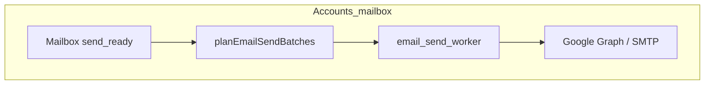
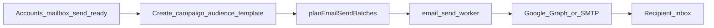

# Email configuration — start to end

Operator guide for Campaign **Configuration → Email**: outbound campaign, daily-report, and sender-verify mail uses the **My Accounts mailbox** for that organization.

**Code anchors**

| Area | Path |
|------|------|
| Env | `backend/src/config/env.ts` |
| Mailbox send | `backend/src/services/accounts-email-send.ts` |
| Config DAO / Ready | `backend/src/dao/email-config.ts` |
| Batch plan gate | `backend/src/dao/email-send-runner.ts` |
| Send worker | `backend/src/services/email-send-worker.ts` |
| Admin UI | `frontend/src/pages/EmailConfigurationPage.tsx` |

---

## 1. Purpose and mental model

Mailbox providers decide whether mail is trustworthy using **SPF + DKIM + DMARC** on the **From domain**.

| Situation | Typical outcome |
|-----------|-----------------|
| Domain authenticated; From matches approved sender | Inbox (or normal filtering) |
| Unconfigured / wrong From for `domainId` | Spam folder or “can’t verify sender” |
| New domain, no reputation / missing DKIM | Higher spam risk |

**Outbound From** is the connected My Accounts campaign mailbox (Google / Microsoft / SMTP). There is no shared Worktual.tech blast path.



---

## 2. Who does what (RACI)

For branded sending (Mode B), responsibility is split between the platform and the domain owner.

| Task | Who | Where |
|------|-----|--------|
| Campaign app / API host (**A** record) | Platform | Platform DNS |
| **MX** (inbox / replies) | Customer | Customer DNS (keep Gmail / M365) |
| **SPF** (authorize sending IPs) | Customer | Customer DNS (one SPF TXT — merge includes) |
| **DKIM** key generation + signing | Platform | Postfix + OpenDKIM |
| **DKIM** public TXT | Customer | Customer DNS (`s1._domainkey.…`) |
| **DMARC** | Customer | Customer DNS (`_dmarc.…`, start `p=none`) |
| Store `domainId` + `fromMail` + Ready | Platform (Campaign Config) | Campaign DB / env |

### OpenDKIM beyond `opendkim-genkey`

Generating keys is not enough. Ops must also configure:

- **KeyTable** — private key path per selector / domain  
- **SigningTable** — which From domains get which selector  
- **TrustedHosts** — who may submit mail for signing  
- **Milter** wiring into the MTA (Postfix)  
- **Restart** OpenDKIM / Postfix after changes  

Until those are live, DNS can look correct while messages remain **unsigned**.

Campaign sending does **not** require MX to point at Postfix. MX stays with the customer’s mailbox provider so replies work normally.

The campaign app **A** record hosts the product; deliverability still hinges on SPF + DKIM + DMARC alignment with the From domain (plus reputation / warmup).

---

## 3. Outbound mail — My Accounts only

Campaign launch, daily reports, and sender-verify mail use the **org My Accounts mailbox** (Google / Microsoft / SMTP). There is no Worktual `send_campaign` API and no Resend/ESP send path in this service.

Ready for email send = My Accounts mailbox `send_ready` **and** Campaign API env:

- `MS_TOKEN_ENCRYPTION_KEY` (match My Accounts Setup Workspace)
- `GOOGLE_OAUTH_CLIENT_ID` / `GOOGLE_OAUTH_CLIENT_SECRET` for Google OAuth mailboxes
- `MICROSOFT_OAUTH_*` for Microsoft OAuth mailboxes

**One gate for all email launches** (chat launch, on-demand, Personalised CRM): `assertEmailSendPipelineReady` before on-demand A2A prepare, before campaign save (live/scheduled + email), in `planEmailSendBatchesDao`, the email worker, agents `launch_campaign` (via `GET /configuration/email/send-readiness` — no mailbox-only fallback), and Phase 2 test send. Pipeline failures return **400** (not soft `email_send_warning`).

Ops: `GET /health` → `googleOAuthConfigured`, `microsoftOAuthConfigured`, `msTokenEncryptionConfigured`. Logged-in: `GET /api/configuration/email/send-readiness`.

**Stored vs sent HTML (`compiled_html`):** Save and send run `sanitizeCompiledHtmlForStorageAndSend` (strip `<base>`, `contenteditable`, preview `#unsubscribe`; fix invalid `/ css /` comments). Live iframe preview may still inject `<base>` for media — that never persists. Send may still add merge tags, unsubscribe URL, tracking, and public image URLs.

---

## 4. Shared Worktual From — removed

`@worktual.tech` sender rows are **deleted** from `email_senders`. Configuration APIs reject them. Campaign **Ready** and launch From come from the **My Accounts** mailbox only.

### Ready checklist (UI labels)

| Checklist item | UI section |
|----------------|------------|
| Postal address | **1. Company mailing address** |
| Sender verified | **2. Sender emails (From)** — verify / **Set active** / Delete |
| Domain authenticated | **3. Domain authentication** — SPF / DKIM / DMARC + Verify |
| Return-path verified | **4. Return-path / bounce domain** |
| Compliance defaults | Shown on Ready checklist |

Also configure:

| Section | Purpose |
|---------|---------|
| **5. Batches, warmup & health** | Batch size, hourly/daily caps, warmup stage, health status |

### Ready gate

`planEmailSendBatchesDao` refuses to plan if the unified send pipeline is not ready (mailbox + backend env). Example:

> email_oauth_env_missing: GOOGLE_OAUTH_CLIENT_ID and GOOGLE_OAUTH_CLIENT_SECRET not loaded in this Campaign API process …

Health `blocked_sending` also blocks planning.

### Seed shortcut

`npm run db:seed` seeds demo campaigns only. It does **not** seed a Worktual.tech From. Connect a mailbox in Setup for send-ready email.

---

## 5. Mode B — New company branded domain (end-to-end)

Campaign now supports the **Connect domain → generate DKIM → customer DNS → Verify** loop in Configuration → Email.

### Product flow

1. Admin enters a **company domain** (not free webmail) → **Connect domain**.
2. Backend generates RSA-2048 DKIM (`s1` selector by default — CCAAS-compatible):
   - Public `p=` stored + shown as DNS TXT
   - Private key **encrypted** in DB (`dkim_private_key_encrypted`) — **never** returned to the FE
3. UI shows copyable **DKIM / SPF / CNAME / DMARC** records.
4. Customer publishes TXT at their DNS host.
5. **Verify domain** runs live DNS lookups and checks:
   - DKIM `p=` **matches** the stored public key
   - SPF includes `WORKTUAL_SPF_INCLUDE` when set (otherwise a generic `v=spf1 ~all` hint)
   - DMARC present (soft flag)
6. On success: `dkim_ok` / `spf_ok` and status `authenticated`.

### Code anchors

| Piece | Path |
|-------|------|
| Keygen + encrypt + DNS verify | `backend/src/helpers/dkim-crypto.ts` |
| Connect / verify DAO | `backend/src/dao/email-config.ts` (`upsertEmailDomainDao`, `verifyEmailDomainDao`) |
| Schema | `EmailDomain.dkimSelector` / `dkimPublicKey` / `dkimPrivateKeyEncrypted` |
| UI | `frontend/src/pages/EmailConfigurationPage.tsx` § Domain authentication |

### Env (optional)

| Variable | Role | Default |
|----------|------|---------|
| `DKIM_SELECTOR` | DNS selector | `s1` |
| `WORKTUAL_CNAME_TARGET` | CNAME target (mail host) | `worktualservices.info` |
| `DKIM_ENCRYPTION_KEY` | AES key material (hashed) | falls back to `JWT_SECRET` |
| `WORKTUAL_SPF_INCLUDE` | Expected SPF token | unset (generic `v=spf1 ~all` unless you set this) |

### OpenDKIM handoff (required for signed mail)

DNS authentication in Campaign ≠ messages signed yet. After Verify succeeds, ops must follow **[EMAIL_OPENDKIM_HANDOFF.md](./EMAIL_OPENDKIM_HANDOFF.md)**:

1. Decrypt / export the private key (ops API with `x-internal-service-key`)
2. Install into OpenDKIM **KeyTable** / **SigningTable** / milter on the mail host
3. Assign a **new** Postfix `domainId` (customer domain only)
4. Save that `domainId` in Config → Email (domain card) or `PUT …/domains/:id/provider`
5. Activate a From on that domain — live send uses the Accounts mailbox

Until those steps land, branded From may still fail SPF/DKIM alignment at the inbox.

### Customer DNS examples

**SPF** (merge into one TXT if Google/M365 SPF already exists):

| Field | Example |
|-------|---------|
| Host | `@` (or apex domain name) |
| Value | `v=spf1 include:_spf.google.com ~all` (example — use the provider that actually sends) |

**DKIM** (selector `s1`):

| Field | Example |
|-------|---------|
| Host | `s1._domainkey` |
| Value | `v=DKIM1; k=rsa; p=MIIBIjANBgkqhkiG9w0BAQ…` (base64 only — no PEM headers) |

**CNAME** (return-path / mail host):

| Field | Example |
|-------|---------|
| Host | `mail` |
| Value | `worktualservices.info` |

**DMARC** (monitor mode first):

| Field | Example |
|-------|---------|
| Host | `_dmarc` |
| Value | `v=DMARC1; p=none; rua=mailto:dmarc-reports@customerdomain.com` |

**Warnings**

- Never create two SPF TXT records — merge includes.  
- Verify DKIM with:  
  `dig TXT s1._domainkey.customerdomain.com +short`  
- Do not use a blocked sender domain. Connect a customer mailbox.
- Private DKIM key must never appear in browser/network responses.

*Shared Worktual.tech sending is removed — connect a mailbox or complete branded domain.*

---

## 6. Launch path (after mailbox Ready)



From address is the connected Accounts mailbox, not a blocked sender domain.

---
Batches respect suppression list + caps. The worker applies merge tags and a postal footer from the org profile.

---

## 7. Verification and troubleshooting

### Dig checks (use the real domain; no typos)

```bash
# SPF
dig TXT example.com +short

# DKIM (selector s1 — adjust if DKIM_SELECTOR differs)
dig TXT s1._domainkey.example.com +short

# DMARC
dig TXT _dmarc.example.com +short
```

Also useful: MxToolbox SPF / DKIM / DMARC checkers.

### Common issues

| Symptom | Likely cause |
|---------|----------------|
| Outlook “can’t verify sender” | From ≠ approved address for that `domainId` (e.g. custom From with `11165`) |
| Spam / junk | New domain reputation, missing/failing DKIM, SPF fail, suspicious headers |
| Plan error “not Ready” | Incomplete Configuration → Email checklist |
| Plan error “blocked” | Caps health = `blocked_sending` |
| UI Active sender ignored on live Worktual send | Retired — mail uses Accounts mailbox |
| DNS looks fine but mail unsigned | OpenDKIM KeyTable / SigningTable / milter not wired |
| DKIM export 401 | Missing/wrong `x-internal-service-key` |

### Multi-channel note

Email **Ready** is independent of App Push / Web Push configuration. Each channel has its own config and readiness.

### FAQ (locked decisions)

| Question | Answer |
|----------|--------|
| Can pasting SPF + DKIM into customer DNS be automatic? | Not today. Future registrar APIs; for now ops/UI shows values to paste. |
| Is spam mainly from a “new automated sender”? | Reputation and warmup matter; correct SPF/DKIM/DMARC + headers reduce untrusted/spam risk but do not guarantee inbox. |

---

## 8. Out of scope / future

- Fully automatic DNS paste into customer registrars  
- Full warmup / IP reputation ops runbook (warmup stage is stored in UI; enforcement is limited today)  
- Automatic push of private keys onto OpenDKIM without ops (SSH/API to mail host)  
- Web push configuration (separate channel)

---

## Quick reference

| | Accounts mailbox (live) |
|--|-------------------------|
| From | Connected Google / Microsoft / SMTP mailbox for that org |
| Campaign send | `accounts-email-send.ts` via `email-send-worker.ts` |
