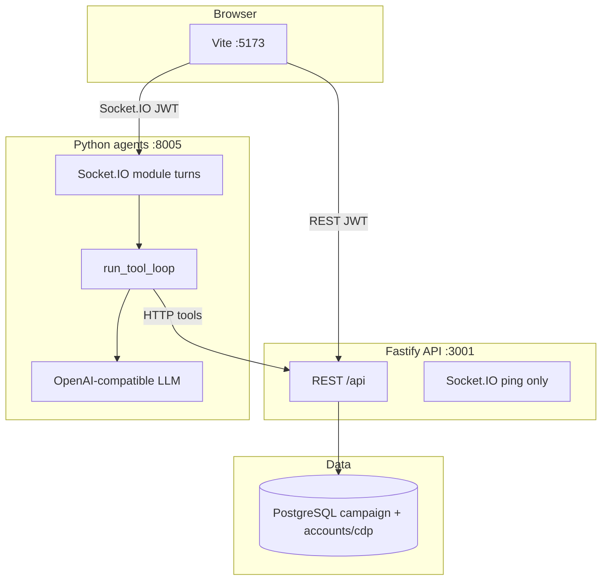
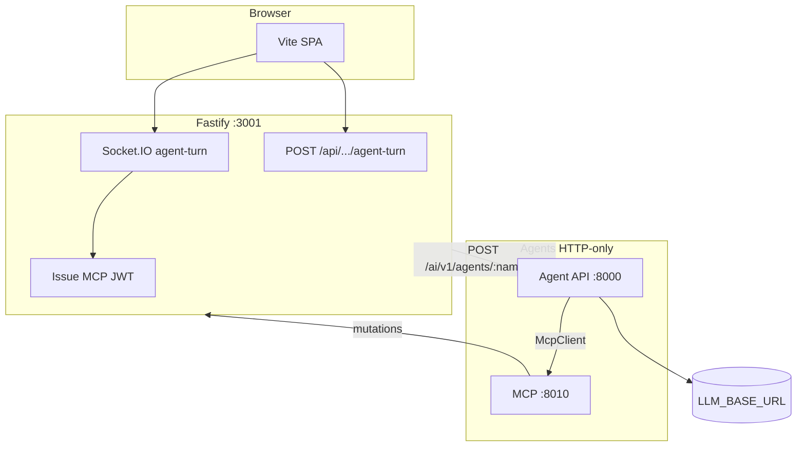

# Process topology

## Today (campaign-ms)

**Note:** Agent chat transport currently lands on **Python Socket.IO**. Backend Socket.IO is not the coworker turn path yet.

## Target (CRM migration blueprint)

### Migration phases

| Phase | Status | Work |
|-------|--------|------|
| P0 | Done | This docs pack |
| P1 | Done | 6-section prompts + dynamic Context (all modules) |
| P2 | Done | `agent.py` layout, strip happy-path regex routing |
| P2b | Done | Create-campaign strategist journey (chat accept) |
| P3 | Planned | HTTP agent API; Fastify owns Socket.IO; Python HTTP-only |
| P4 | Planned | MCP `:8010` catalog + JWT |
| P5 | Planned | Orchestrator envelope, tool budget, optional Redis STM |

Never expose MCP or LLM URLs to the browser.
