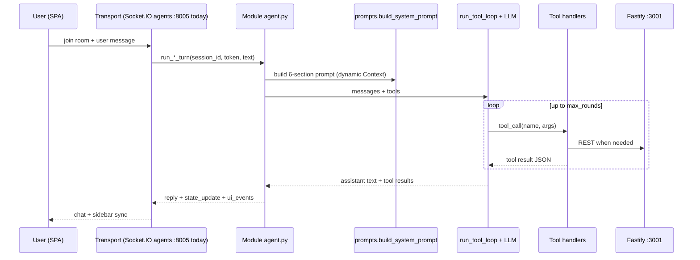

# End-to-end agent turn (overview)

## Principles

1. **Module routing** — client sends `module` (or hub opens a destination). Server runs that module’s agent. Cross-module moves use LLM tools (`ROUTE_TO_MODULE`, `OPEN_HUB_DESTINATION`).
2. **No happy-path regex** on user text for tool choice.
3. **Tools change state**; chat text explains results.
4. **User-facing replies** prefer tool `message` when authoritative tools ran; never leak internal tool names.

## Shared runtime

- `agents/app/llm.py` — LLM client
- `agents/app/runtime/agent.py` — `run_tool_loop`
- `agents/app/memory.py` / `session_store.py` — session messages + campaign state
- `agents/app/prompt_sections.py` — sectioned prompts

See per-module files under `workflow/`.
