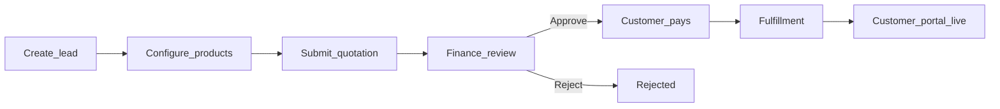
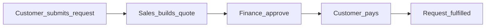

# Worktual Accounts — Knowledge Transfer (Flows & Roles)

> **Master KT (DB + portals + action maps):** [`knowledge.md`](./knowledge.md). Prefer updating that file first when login, schemas, or flows change. This document stays a narrative deep-dive on roles and flows.

This document explains **who does what** across the MY_ACCOUNTS / Worktual Accounts product: portals, roles, and the main end-to-end flows.

Use it for onboarding engineers, QA, and support.

---

## 1. Big picture

Worktual Accounts is a multi-portal app:

| Portal | Who uses it | Typical home |
|--------|-------------|--------------|
| **Sales** | Sales executives | `/dashboard` |
| **Sales Admin** | Sales managers / ops | `/dashboard` (+ sales oversight) |
| **Finance** | Finance team | `/finance/queue` |
| **Admin** | Platform admins | `/admin/users` |
| **Customer** | Paying customers (org / branch users) | `/customer/dashboard` |
| **Partner** | Referral partners | `/partner/dashboard` |
| **Reseller** | Resellers | `/reseller/dashboard` |

**Unified login** at `/` (`POST /api/auth/sign-in`) tries account types in order:

1. Internal staff (admin / sales / sales_admin / finance)  
2. Reseller  
3. Partner  
4. Customer  

Each portal has its own shell (sidebar/nav) and session storage.

---

## 2. Roles — who is involved and what they do

### 2.1 Admin

**Purpose:** Configure the platform and unlock stuck accounts.

**Main work:**
- Manage staff users (sales, finance, sales_admin) — create, edit, bulk upload, force logout  
- Manage **customer portal users** — view directory, force logout  
- Manage **partners** and **resellers** (CRUD, force logout)  
- Edit **pricing catalog**  
- Manage **commission slabs**  
- Approve/reject **branch/product cancellation** requests  
- Sales oversight (agents, lead reassignment)  
- Connect Outlook for admin mailbox  

**Does not:** Run day-to-day lead quoting or finance approval as their primary job (they can still access oversight/mail).

**Key UI:** `/admin/*` via `AdminShell`

---

### 2.2 Sales executive

**Purpose:** Own leads from creation through quotation email.

**Main work:**
- Create and edit **their** leads (onboarding)  
- Configure products and pricing for a lead  
- Generate quotation → send via Outlook compose  
- Forward payment links when needed  
- Handle support for their accounts  
- Pick up **customer product requests** on leads they can see  
- Connect Outlook for sending mail  

**Limits:**
- Sees leads they created or are assigned to  
- **Cannot** create quotations for **reseller-owned** leads (sales_admin can)  
- Subject to **single active session** (one device at a time)

**Key UI:** `/dashboard`, `/onboarding`, `/products/:leadId/*`, `/mail`

---

### 2.3 Sales admin

**Purpose:** Same sales workspace as executives, plus team oversight and broader quote rights.

**Main work:**
- Everything a sales executive can do  
- Sales oversight: agents, lead assignment, portfolio views  
- Create quotations for leads sales agents cannot (e.g. reseller leads)  
- Reassign customers/leads when an agent leaves  

**Key UI:** Sales workspace + `/sales-oversight/*`

---

### 2.4 Finance

**Purpose:** Approve quotations and drive payment to completion.

**Main work:**
- Review quotations in the finance queue  
- Approve → issue Stripe/Razorpay payment link (or offline bank instructions)  
- Reject quotations  
- Confirm / sync / mark payments paid  
- Partner commission payouts  
- Connect Outlook for finance mailbox  

**Does not:** Create leads or edit pricing catalog.

**Key UI:** `/finance/queue`, `/finance/commissions`, `/finance/mail`

---

### 2.5 Customer (org admin / branch user)

**Purpose:** Self-serve after they have paid and portal access is provisioned.

**Main work:**
- View subscribed products  
- Request **new products** or **upgrades/add-ons**  
- Withdraw open product requests (before quote advances)  
- Request product cancel or branch drop  
- Raise support tickets  
- Update account / password  
- Complete customer onboarding / operational hub steps  

**Limits:**
- Branch users are scoped to their branch  
- Portal appears after payment fulfillment / provisioning  
- Single active session  

**Key UI:** `/customer/*`

---

### 2.6 Partner

**Purpose:** Refer companies; track progress and commissions.

**Main work:**
- Create referral leads (typically **unassigned** until sales picks up)  
- Track lead / quote status (read-oriented)  
- Maintain bank details  
- View commissions  

**Does not:** Run the full product quote workflow themselves.

**Key UI:** `/partner/*`

---

### 2.7 Reseller

**Purpose:** Create and track reseller-sourced customers.

**Main work:**
- Create leads (auto-routed toward sales admin ownership model)  
- View leads, renewals, invoices  

**Limits:**
- Sales executives cannot quote reseller leads; **sales_admin** can  

**Key UI:** `/reseller/*`

---

## 3. Core business flows

### 3.1 New customer journey (lead → paid → portal)

This is the main revenue path.

| Step | Who | What they do |
|------|-----|----------------|
| 1. Create lead | Sales, Partner, Reseller, or external form | Company, contacts, HQ/branch addresses, tax IDs |
| 2. Configure products | Sales / Sales admin | Pick products, regions, CCaaS plans, pricing, branches |
| 3. Submit quotation | Sales / Sales admin | Compose email + `POST /api/quotations` → status **Pending Finance Review** |
| 4. Finance review | Finance | Approve (payment link / offline) or Reject |
| 5. Pay | Customer (link) or Finance (mark-paid / confirm) | Stripe, Razorpay, or offline bank |
| 6. Fulfill | System | Organization, subscriptions, portal users, welcome email |
| 7. Use portal | Customer | Login at `/` → customer dashboard |

**Lead statuses (high level):**  
`New` → `In Progress` / `Qualified` → `Pending Finance Review` → `Approved` → `Partially paid` / `Paid` (or `Rejected`)

**Quotation statuses:**  
`Pending Finance Review` → `Approved` → `Paid` (or `Rejected`)

**Key areas in code:**
- Onboarding: `src/pages/OnboardingPage.jsx`, `server/leads.js`  
- Quote workflow: `src/pages/ProductWorkflowPage.jsx`, `src/pages/ComposeEmailPage.jsx`, `server/quotations.js`  
- Finance: `src/pages/FinanceQueuePage.jsx`  
- Payments: `server/payments/*`  
- Portal: `server/customerAuth.js`, `src/pages/customer/*`

---

### 3.2 Customer product request (mid-life purchase)

Used when an **existing** customer wants another product or upgrade.

| Step | Who | What they do |
|------|-----|----------------|
| 1. Submit request | Customer | `/customer/products/request` (or upgrade from a product) |
| 2. See status | Customer | **Sent to sales** until a quote exists |
| 3. Open request on lead | Sales / Sales admin | Lead dashboard → Customer product requests |
| 4. Quote | Sales / Sales admin | Workflow locked to that request (`sourceProductRequestId`) |
| 5. Approve + pay | Finance + Customer | Same payment path as new sale |
| 6. Status updates | System + UI | **Quotation ready / awaiting payment** while quote is pending/approved unpaid; **Completed** / removed when fulfilled after pay |

**Customer-visible statuses (simplified):**

| Situation | Customer sees |
|-----------|----------------|
| Just submitted | Sent to sales |
| Quote with finance / approved, not paid | Quotation ready / awaiting payment |
| Paid / fulfilled | Payment received → then request leaves the open list |

**Key areas:**  
`server/customerProductRequests.js`, `src/pages/customer/CustomerProductsPage.jsx`, `src/pages/ProductWorkflowPage.jsx`, payment fulfillment in `server/payments/fulfillment.js`

---

### 3.3 Outlook / Microsoft mail connect

**Who:** Sales, Sales admin, Finance, Admin (not customers).

| Step | Who / what | Behavior |
|------|------------|----------|
| 1. Connect Outlook | User clicks Connect | Opens Microsoft sign-in in a **new tab** (popup helpers) |
| 2. Sign in at Microsoft | User | Consents / authenticates |
| 3. Callback | Server | `/api/mail/oauth/callback` stores tokens |
| 4. Return to app | Browser | Popup notifies original tab; original tab refreshes mail connection |
| 5. Auto-connect after login | System | May still use **same-tab** redirect (login path) |
| 6. Send mail | Sales | Compose quotation emails from connected mailbox |

**Key areas:**  
`src/lib/email.js`, `src/pages/MailPage.jsx`, `server/msGraphOAuth.js`

---

### 3.4 Login, logout, and “already logged in”

**Rule:** Non-admin accounts allow **one active server session** at a time (24h server TTL). Client also idle-logs out after ~2 hours of inactivity.

| Event | Who | What happens |
|-------|-----|----------------|
| Login | Any portal user | If another unexpired session exists → **409** “already logged in on another device” |
| Normal logout | User | Clears browser session **and** revokes server session (staff / partner / reseller / **customer**) |
| Idle logout | Browser idle timer | Same as logout (customer now also hits server logout) |
| Force logout | Admin | Clears all sessions for that user so they can log in again |
| Admin login | Admin | Exempt from single-session lock |

**Customer-specific note:** Historically, customer logout only cleared localStorage and left a DB row for up to 24h. Logout now calls `POST /api/v1/customer/logout` so re-login works after signing out.

**Admin escape hatches:**
- `/admin/users` — staff force logout  
- `/admin/customer-portal-users` — customer force logout  
- Partner / reseller admin pages — force logout  

---

### 3.5 Payments (Stripe / Razorpay / offline)

| Actor | Action |
|-------|--------|
| Finance | Approves quote → system issues payment link(s) by policy |
| Customer | Pays via Stripe or Razorpay checkout |
| Finance | Can report/confirm bank payments, mark paid, or sync gateway status |
| System | Webhooks record paid → fulfillment (products, portal, emails) |

**Amount policy (INR, high level):**
- Very large amounts may be **offline only**  
- Mid-high amounts may be **Stripe only**  
- Lower amounts can use Stripe or Razorpay  

**Key areas:**  
`server/payments/index.js`, `stripe.js`, `razorpay.js`, webhooks, `fulfillment.js`, `src/lib/paymentProviderPolicy.js`

---

### 3.6 Branch / product cancellation

| Step | Who | What they do |
|------|-----|----------------|
| 1. Request | Customer | Cancel a product at a branch, or drop a whole branch (`immediate` or end of period) |
| 2. Review | Admin | Cancellation queue — approve or reject |
| 3. Apply | System / jobs | Schedules or applies lifecycle changes |
| 4. Withdraw | Customer | Can withdraw while still open |

Open cancellation / branch-drop requests can **block** new product requests for that scope.

**Key areas:**  
`server/branchCancellationRequests.js`, `server/branchLifecycle.js`, Admin cancellation queue, customer products UI

---

### 3.7 Partner referral path

| Step | Who | What they do |
|------|-----|----------------|
| 1. Create lead | Partner | Referral lead (unassigned) |
| 2. Claim / assign | Sales / Sales admin | Take ownership |
| 3. Quote → pay | Sales + Finance + Customer | Same as main journey |
| 4. Commission | Finance / Partner | Track and pay commissions per slabs |

---

### 3.8 Reseller path

| Step | Who | What they do |
|------|-----|----------------|
| 1. Create lead | Reseller | Lead created under reseller ownership model |
| 2. Quote | **Sales admin** (not regular sales) | Build and submit quotation |
| 3. Pay / fulfill | Finance + Customer + System | Same payment pipeline |
| 4. Track | Reseller | Leads, renewals, invoices views |

---

## 4. Address and data rules (sales onboarding)

When creating leads / resellers:

- **HQ billing address** and **branch addresses** are required where applicable  
- Addresses must be **unique** across HQ + branches of the same company  
- Format: letters, numbers, spaces, and `, . - / # '`  
- Tax, email, and mobile have their own country-specific rules  

**Key areas:**  
`src/lib/leadAddresses.js`, `server/leadContactValidation.js`

---

## 5. Deploy environments (ops note)

| Environment | How it updates |
|-------------|----------------|
| **Staging** | Auto-deploys on push to `main` (`scripts/deploy.sh` + systemd) |
| **QA** | Manual GitHub Action: **Deploy QA** |

Deploy builds `frontend/` + `backend/` separately, copies the SPA into workspace `dist/` (with `deploy-meta.json`), migrates, and restarts `worktual-mail-api` with `SERVE_FRONTEND=true`.

A green QA deploy means the QA runner’s local app health-checked successfully; always hard-refresh the browser after deploy.

---

## 6. Suggested learning path

1. Login + shells (`src/App.jsx`, portal shells)  
2. Lead create → quote → finance (`OnboardingPage` → `ProductWorkflowPage` → `ComposeEmailPage` → `FinanceQueuePage`)  
3. Payments + fulfillment (`server/payments/*`)  
4. Customer portal + product requests  
5. Mail OAuth  
6. Sessions / force logout  
7. Cancellations + admin pricing/users  

---

## 7. Glossary

| Term | Meaning |
|------|---------|
| Lead | Prospect / deal record before or during sale |
| Quotation | Formal quote sent to finance / customer |
| Fulfillment | Post-payment activation of products + portal |
| Product request | Existing customer asking for new/upgrade products |
| Organization | Customer company record after conversion/pay |
| Force logout | Admin clears server sessions so user can sign in again |
| Single session | Only one active login token per non-admin account |

---

*Last updated to reflect current MY_ACCOUNTS portal flows (sales, finance, admin, customer, partner, reseller).*
