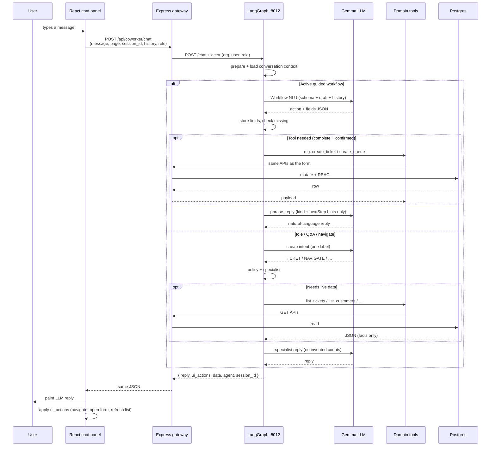

# Worktual agents — how chat is built

This is the source-of-truth for the co-worker agents: **tech stack**, **what chat can do**, and **the path from a user message to a painted reply**.

Service: [`ai-agents/`](../ai-agents/) (FastAPI, port **8012**).  
Frozen ownership: [`architecture-freeze.md`](./architecture-freeze.md).  
Ops / env / MCP: [`ai-agents/README.md`](../ai-agents/README.md).

---

## 1. Tech stack

| Layer | Technology | Role |
|-------|------------|------|
| UI | React + TypeScript (`ui-frontend`) | Chat panel, forms, apply `ui_actions` |
| Gateway | Express + TypeScript (`ui-backend`) | Cookie JWT auth, RBAC, proxy to agents, **all DB mutations** |
| Agents | Python 3 + **FastAPI** + **Uvicorn** | Chat orchestration, phrasing, triage-assign |
| Graph | **LangGraph** + LangChain | Multi-node graph, checkpointer, park/resume |
| LLM | **Gemma** via OpenAI-compatible API (`worktual-gemma`, `MODEL_URL`) | NLU, field extract, reply wording (never SQL / RBAC) |
| Tools | `app/tools/*` → Express HTTP (or optional **Ticketing MCP**) | Controlled operations only |
| Data | **PostgreSQL** (`ticketing.*`, org-scoped) | Source of truth |
| Memory | LangGraph `InMemorySaver` + durable conversation context | Session drafts, `last_entity`, parked workflows |

Python packages (see `ai-agents/requirements.txt`): `fastapi`, `uvicorn`, `langgraph`, `langchain`, `langchain-openai`, `pydantic-settings`, `httpx`, `psycopg`.

Default tool transport is **Express** (`TOOLS_TRANSPORT=express`). Optional MCP: `TOOLS_TRANSPORT=mcp` + `mcp-server/` on `:8020`. Express remains the only writer.

---

## 2. Responsibility split (frozen)

| Layer | Owns |
|-------|------|
| **Gemma / NLP** | Meaning, field extraction, coreference, wording |
| **LangGraph** | Workflow state, park/resume, progression, tool orchestration |
| **Tools** | Named operations (`create_ticket`, `create_queue`, …) |
| **Express** | RBAC, validation, business rules, mutations, audit |
| **Postgres** | Business data |
| **React** | UI chrome + applying `ui_actions` (navigate, filters, open forms, refresh) |

**Do not:** let Gemma write SQL, skip Express RBAC, or invent a separate chat architecture per module.  
**Do:** one product loop for every module — only the **workflow schema** and **tool allowlist** change.

```text
Understand → Extract → Store → Check missing → Act → Update state → Respond
```

---

## 3. Graph (one entry, every turn)

```text
START → prepare → workflow_manager
                 ├─ handled → END
                 └─ continue → commands (shim)
                               ├─ handled → END
                               └─ continue → cheap intent → policy → specialist → END
```

| Node | File | Job |
|------|------|-----|
| **prepare** | `app/prepare.py` | Hydrate history, org, role, page |
| **workflow_manager** | `app/agents/workflow_manager.py` | Active draft: schema-aware Gemma NLU, continue / park / resume / cancel |
| **commands** | `app/agents/commands.py` + `app/tasks/chat_commands.py` | Idle start of create flows, nav, filters (compat shim) |
| **intent** | `app/agents/intent.py` | Cheap label: `GREETING` \| `CHAT` \| `TICKET` \| `CUSTOMER` \| `KB` \| `TEAMS` \| `CREATE` \| `UPDATE` \| `SEARCH` \| `NAVIGATE` |
| **policy** | `app/agents/policy.py` | Intent → agent + `tools_allowed` + role denials |
| **tickets / teams / kb / customers / general** | `app/agents/*.py` | Lean specialist: Global + agent prompt + history + **at most one** tool round |

**Routing rule**

- **Active workflow** (create ticket, create team, …) → Workflow Manager + schema-aware NLU only. Do **not** re-run cheap intent on field answers (`"Aashika"` while create-ticket awaits name).
- **No active workflow** → cheap intent → policy → specialist.

---

## 4. Chat from user query to response

### 4.1 End-to-end path



### 4.2 What React sends

`ui-frontend` → `POST /api/coworker/chat` (`askCoworkerAgents`):

- `message`, `page` (current view label)
- `session_id` (stable per login session)
- `history` (user/assistant turns; source of truth for continuity)
- optional `ticket_draft` snapshot from Create Ticket

Express attaches **org id, user id, name, role**, `can_create_ticket`, and `X-Coworker-Tasks-Key`, then proxies to `POST :8012/chat`.

### 4.3 What Python returns

```json
{
  "reply": "LLM-written assistant text only",
  "agent": "tickets",
  "session_id": "…",
  "ui_actions": [
    { "type": "navigate", "view": "customers" },
    { "type": "create_customer", "name": "Aashika", "step": "contact" }
  ],
  "data": { "workflow": "create_customer", "step": "contact" },
  "request_id": "…"
}
```

- **`reply`** — always LLM-written. Seeds / `fallback` / `nextStep` are **intent hints into Gemma**, never painted as the bubble (`phrase.py`, no-static-chat-replies rule).
- **`ui_actions`** — React applies them: `navigate`, `set_filter`, `clear_filters`, `create_ticket`, `create_team`, `create_customer`, `create_macro`, `create_kb`, `refresh_tickets`, escalate/update, etc.
- **`data`** — drafts, ticket lists, errors (`serviceError`, `retryable`). Never fake KPIs when empty.

### 4.4 Example: create ticket (staff)

1. User: `create ticket` → WM/commands start `create_ticket`, ask **customer name**, `ui_actions` open Create Ticket.
2. User: `Aashika` → NLU extracts `customerName`, store, ask **email or phone**. Directory bind when contact is known.
3. User: `aashika@example.com` → if not in directory → ask to **add customer** (name kept). If found → ask **issue**.
4. User: issue text → `enrich_ticket` (same Express path as the form) fills subject/priority/description → confirm.
5. User: `confirm` → `create_ticket` tool → Express `POST /api/tickets` → reply + `refresh_tickets`.

If they say `show my open tickets` mid-flow: **park** create-ticket, run the list side quest, then `continue` resumes and asks **only missing fields**.

### 4.5 Example: add customer after unknown name

1. Create-ticket has `customerName=Aashika`, not in directory.
2. User: `add customer` → park ticket, start `create_customer` **seeded with Aashika**, ask email/phone (do not re-ask name).
3. User: email → `create_customer` tool → Express `POST /api/customers` (admin) → refresh Customers list.

---

## 5. Guided workflows (same loop, different schema)

Schemas live in `ai-agents/app/workflow_schemas.py`. Completeness is enforced in LangGraph **before** any write tool.

| Workflow | Required chat fields | Tool | Notes |
|----------|----------------------|------|--------|
| **Create ticket** | name, contact (email **or** phone), issue | `enrich_ticket` then `create_ticket` | Subject/priority/description from enrich, not chat |
| **Create team** | name, description; members optional/skip | `create_queue` | Never ask Private/Shared (DB is Shared) |
| **Add team members** | team, members | `update_queue` | Distinct from create-team |
| **Delete / edit team** | confirm / new name | `delete_queue` / `update_queue` | Admin |
| **Add customer** | name, contact | `create_customer` | Admin; persist directory + CDP; seed name from parked ticket |
| **Create macro** | title, body | `create_macro` | |
| **Create KB** | title, category, body | `create_kb_article` | |
| **Create priority** | display name, SLA hours | `create_priority` | Admin |
| **Create status** | display name | `create_status` | Admin |
| **Escalate** | ticket number, assignee (or best resolver) | `escalate_ticket` | Keeps L1; sets `resolver_*` |
| **Reassign** | ticket number, target role, person | `update_ticket` or `escalate_ticket` | Workflow id `reassign_ticket`; no tool with that name |

State keys (adapters until fully drained): `ticket_draft`, `team_draft`, `customer_draft`, `macro_draft`, `kb_draft`, `priority_draft`, `escalate_draft`, `parked_drafts`, `last_entity`, `current_workflow`, `current_step`.

---

## 6. Functionalities (what chat can do)

### 6.1 Navigate & filters

Open any role-allowed module (`customers`, `kb`, `agent-queues`, `macros`, `priorities`, My Tickets, Unassigned, Search, CSAT, audit, …).  
Set/clear filters (status, priority, channel, customer Active/Inactive, search query).  
Reply acknowledges; **live rows** come from Express list APIs, never invented.

### 6.2 Tickets

- List / search / “my tickets” / unassigned / team inbox (scoped by role).
- Create ticket (directory customer only).
- Escalate / reassign, update status or priority, add internal note.
- Portal customer: session-bound identity; chat collects **issue only** → `portal_create_ticket`.

### 6.3 Teams / queues

Create team (name → description → members/skip), add/remove members, edit name/description, delete (confirm). List/search teams.

### 6.4 Customers

Search directory, Active/Inactive filters. **Add customer** (admin): name → email or phone → persist directory + CDP + refresh.

### 6.5 Knowledge base & macros

Create KB article (title → category → body). Search articles. Create/delete macros.

### 6.6 Catalog & ops (mostly admin)

Priorities / statuses, escalation directory nav, org preferences, notifications mark-read, metrics/analytics **via tools** (not hardcoded UI numbers). Co-worker metrics Q&A prefers **`ask_semantic_layer`** (scoped by `organization_id`); Dashboard UI pages still load Express `/api/metrics` directly.

### 6.7 Triage-assign (not chat)

Separate job: `POST /tasks/triage-assign` (Express `/api/tickets/enrich`).

| Step | Module | Output |
|------|--------|--------|
| Categorize | `app/tasks/triage.py` | category, skill, priority, subject, description |
| Queue | org `agent_queues` | team/queue |
| Assign | `app/tasks/assign.py` | L1 agent by skill + workload; optional L2 resolver if confidence ≥ threshold |

Used when staff create-ticket has name + contact + issue (chat or form). If agents are down, Express falls back to Node enrich.

### 6.8 Phrase & ticket-reason helpers

- `POST /tasks/phrase` — LLM wording for guided kinds (`start`, `got_name`, `created`, …).
- `POST /tasks/ticket-reason` — optional intent reasoner for Create Ticket UI corrections.

---

## 7. Tools & RBAC

Allowlists: `ai-agents/app/tools/registry.py` (code-owned, not LLM-configurable).

| Agent | Example tools |
|-------|----------------|
| tickets | `list_tickets`, `get_ticket`, `create_ticket`, `enrich_ticket`, `escalate_ticket`, `update_ticket`, `add_ticket_note`, portal variants |
| teams | `list_queues`, `create_queue`, `update_queue`, `delete_queue` |
| customers | `list_customers`, `create_customer` |
| kb | `list_kb`, `create_kb_article` |
| general | macros, queues, kb, customers, metrics, analytics, org prefs, notifications |

Role → modules: `ai-agents/app/rbac.py` (mirrors `ui-frontend/src/rbac.ts`). Examples:

- **Admin** — full catalog + add customer + create team.
- **Agent** — create ticket, customers **read**, macros, KB; cannot add customers / create teams.
- **Resolver** — assigned + work board + KB; no create ticket.
- **Viewer / portal** — read-scoped; portal files only as the signed-in customer.

Express `requireAuth` + `requireModule` is the final gate even if the graph proposed a tool.

---

## 8. LLM usage (what Gemma is for)

| Call | When | Output |
|------|------|--------|
| **Workflow NLU** | Active draft | Closed JSON: `CONTINUE_WORKFLOW`, `SIDE_QUEST`, `CANCEL_WORKFLOW`, `fields`, … |
| **Cheap intent** | Idle / after WM defers | One label word |
| **Phrase** | Guided next question / success / validation | 1–3 sentence reply |
| **Specialist** | Q&A after intent+policy | Reply; may request **one** tool then a final sentence |

Gemma does **not** invent ticket counts, CSAT, directory rows, or “created” before a successful tool. Empty DB → empty UI / honest “none yet”.

---

## 9. Memory & sessions

- Client **history** + `session_id` seed LangGraph messages every turn.
- Checkpointer keeps drafts across turns (`org:session_id` thread).
- Durable `conversation_context` stores `active_workflow`, `parked_workflows`, `last_entity`, `last_query`.
- Side quest → **park** current draft; resume does not re-ask filled fields.

---

## 10. Surfaces & endpoints

| Surface | URL | Purpose |
|---------|-----|---------|
| Staff chat | `POST /api/coworker/chat` → `POST :8012/chat` | Co-worker |
| Portal chat | `POST /api/portal/chat` → same `/chat` (`surface=portal`) | Customer portal |
| Health | `GET :8012/health` | Model + task list |
| Triage | `POST :8012/tasks/triage-assign` | Enrich / assign |
| Phrase | `POST :8012/tasks/phrase` | Guided wording |
| Express enrich | `POST /api/tickets/enrich` | Proxies triage |

Run agents:

```bash
cd ai-agents
source .venv/bin/activate
uvicorn app.main:app --host 127.0.0.1 --port 8012
```

---

## 11. Channel adapters (Slack / Teams / WhatsApp — design)

Adapters must not invent business logic. Same registry as web chat:

```text
Channel adapter → actor (user ↔ org) → LangGraph /chat or tool
  → Tool Registry → Express (RBAC + audit) → PostgreSQL
```

Password / API-key / delete-data stay **web Settings only**.

---

## 12. Code map

| Concern | Path |
|---------|------|
| Graph | `ai-agents/app/graph.py`, `app/state.py` |
| Workflow schemas | `ai-agents/app/workflow_schemas.py` |
| Workflow manager | `ai-agents/app/agents/workflow_manager.py` |
| Workflow NLU prompt | `ai-agents/app/prompts.py` (`WORKFLOW_NLU_SYSTEM`) |
| Phrase | `ai-agents/app/tasks/phrase.py` |
| Chat / catalog commands | `ai-agents/app/tasks/chat_commands.py`, `catalog_commands.py` |
| Tools | `ai-agents/app/tools/catalog_tools.py`, `ticket_write.py`, `registry.py` |
| UI actions catalog | `ai-agents/app/tasks/ui_actions.py` |
| Express gateway | `ui-backend/server.ts` (`/api/coworker/chat`) |
| React chat | `ui-frontend/src/config/coworker.ts`, `components/coworker/*` |

---
## 13. Complete end-to-end “chat turn” contract (Express ↔ LangGraph ↔ React)

Every user message becomes exactly one **agent turn** through the following pipeline:

1. **React (UI)** sends: `POST /api/coworker/chat`
   - `message`, `page`, `session_id`
   - `history` (the transcript the user sees)
   - optional `ticket_draft` snapshot (when coming from a guided form)

2. **Express gateway (ui-backend)**:
   - authenticates user (cookie JWT)
   - sets tenant context (`organization_id`)
   - enforces RBAC (`role → allowed modules/tools`)
   - forwards to the agent service (`POST :8012/chat`)

3. **LangGraph (ai-agents :8012)**:
   - loads/normalizes durable `conversation_context`
   - runs the workflow graph for that turn
   - returns an agent result containing:
     - the LLM-written assistant reply
     - requested tool actions (only as proposals)
     - UI patches/actions for guided forms

4. **React applies the result**:
   - paints the assistant text
   - applies `ui_actions` / patches
   - refreshes any requested lists

### 13.1 Public UI protocol (CRM-style envelope)

Internally we do extra orchestration, but the UI only consumes a CRM-style envelope (see `ai-agents/app/agent_turn.py`):

- `assistantText`: **LLM-written text only** (no hardcoded bubbles; no tool syntax)
- `toolProposals`: structured tool calls the UI can confirm (when needed)
- `patch`: draft-field updates for the open guided form (never treated as “writes” by itself)
- `sessionMemoryPatch`: durable state updates to `conversation_context` (park/resume, drafts, last entity, etc.)
- `uiRefresh`: list of list-refresh operations (tickets/teams/kb/etc.)

The **Super Agent JSON** used for parking/resuming is internal and is **not** directly copied to the UI.

---
## 14. Durable memory (conversation_context): what we store and why

LangGraph uses an in-process checkpointer for drafts, but the durable “truth” is the Postgres-backed
`conversation_contexts` record (or via the memory API).

Durable memory fields are normalized by `ai-agents/app/workflow_state.py:normalize_conversation_context()`.
The canonical shape includes:

- `active_agent`: which specialist owns the current workflow (normalized module name)
- `last_entity`: last entity remembered (ticket/customer/team/article/etc.)
- `recent_entities`: up to 12 recent entities (used for disambiguation)
- `last_query`: the last structured list/search query state (rows removed)
- `active_workflow`: `{ workflow_type, step, data, status, version }` or `None`
- `parked_workflows`: a list of parked workflows (so side quests can resume)
- `tool_memory`: compact summary of the most recent tool outcome
- `last_user_message`: the user text from the last turn
- `last_assistant_reply`: the assistant reply from the last turn (trimmed)
- `recent_history`: last ~20 transcript turns (`_DURABLE_HISTORY_CAP = 20`)
- `last_super_agent_decision`: compact record of the last “workflow NLU decision”

### 14.1 tool_memory (how tools affect next-turn reasoning)

Tool results are compacted by `compact_tool_memory(tool_name, result)` and merged into context:

- `last_tool`: tool name (or `unknown`)
- `{tool_name}: { count, entities }`: extracted entity-like rows (best-effort)
- `last_result: { items: entities }`
- `last_tool_outcome`: on success/failure
  - `success` (boolean)
  - on failure: `error_code`, `error` (short message)

This is how:
- confirmations (“yes/go ahead”) can mean “start the next flow” after a failed tool, and
- the Super Agent can decide whether to park/resume vs. treat the user message as a new task.

### 14.2 last_user_message + last_assistant_reply (affirmation resolution)

The workflow NLU uses:
- `last_tool_outcome` (success/failure)
- `last_assistant_reply` (what the assistant last asked)

Together they resolve whether user “yes” means:
- proceed with the same workflow, or
- start a new workflow (example: ticket creation failed due to “customer not found” → “yes” should start `create_customer`, not loop).

---
## 15. Tool system: allowlists, tool proposals, and Express as the writer

Chat “tools” are controlled operations that map to Express endpoints.
LLM output never directly mutates Postgres; it can only request a tool call.

### 15.1 Tool allowlists (code-owned)

Allowed tools per specialist/module are defined in `ai-agents/app/tools/registry.py`:

- `TOOL_ALLOWLIST[agent] = { tool names }`
- examples:
  - `tickets` can call `create_ticket`, `update_ticket`, `list_tickets`, `get_ticket`, etc.
  - `teams` can call `create_queue`, `update_queue`, `delete_queue`, etc.
  - `customers` can call `create_customer`, `list_customers`, etc.
  - `kb` can call `create_kb_article`, `publish_kb_article`, etc.
  - `admin` can call analytics, CSAT reports, audit listing, preferences, etc.

The graph also uses RBAC (matching `ui-frontend/src/rbac.ts`) as an additional gate.

### 15.2 Confirmation vs auto-exec (safety boundary)

Even if a specialist proposes a tool, the runtime:
- validates that the tool is allowed for that agent/module
- checks confidence + risk implied by the tool’s metadata
- may require explicit user confirmation before treating it as a “write”

Practically:
- **Low-risk reads/list/search** are usually just executed to answer the question.
- **Guided form writes** happen after the user confirms the final step.
- Tool writes are still ultimately executed by Express (RBAC + validation + DB mutation).

### 15.3 tool transport (Express vs MCP)

Tool calls can route either to:

- **Express directly** (default): `TOOLS_TRANSPORT=express`
- **Ticketing MCP server** (optional): `TOOLS_TRANSPORT=mcp` + `MCP_SERVER_URL=http://127.0.0.1:8020`

The tool allowlist stays the same; only the transport changes.

---
## 16. Workflow schemas (guided create/update lifecycles)

Guided flows (create ticket, add customer, create KB, create team, escalate, etc.) are defined
in `ai-agents/app/workflow_schemas.py`.

### 16.1 What the Workflow Manager does

`ai-agents/app/agents/workflow_manager.py` is responsible for:
- schema-aware interpretation of the current draft (`workflow NLU`)
- deciding what to do next:
  - `CONTINUE_WORKFLOW`
  - `SIDE_QUEST` (park + resume)
  - `CANCEL_WORKFLOW`
  - `RESUME_WORKFLOW`
  - `CONFIRM_WORKFLOW` (synonym for `CONTINUE_WORKFLOW` at a confirm step —
    both are treated identically by `chat_commands.py` and `base.py`; the prompt
    prefers `CONTINUE_WORKFLOW`, but `CONFIRM_WORKFLOW` is accepted if emitted)
- ensuring that required fields are collected before any write tool is called

The actual interpretation is performed by the LLM using `WORKFLOW_NLU_SYSTEM` (see `ai-agents/app/prompts.py`).

### 16.2 Missing-field enforcement

Field completeness is enforced before writes using:
- the workflow schema definition
- `missing_fields(workflow_id, data)` logic

When required fields are missing:
- the agent asks only for the missing slot(s)
- the draft remains in `conversation_context.active_workflow.data`

### 16.3 Workflow draft keys (migration contract)

Legacy `*_draft` keys are kept as projections of `conversation_context` to avoid breaking older code.
The mapping between workflow IDs and draft keys is frozen in `ai-agents/app/workflow_state.py`.

Examples:
- `WF_CREATE_TICKET` ↔ `ticket_draft`
- `WF_CREATE_MACRO` ↔ `macro_draft`
- `WF_CREATE_CUSTOMER` ↔ `customer_draft`
- `WF_CREATE_TEAM` ↔ `team_draft`
- `WF_CREATE_KB` ↔ `kb_draft`
- `WF_CREATE_PRIORITY` ↔ `priority_draft`
- `WF_CREATE_STATUS` ↔ `priority_draft`
- `WF_ESCALATE` ↔ `escalate_draft`

During a guided workflow, the graph uses draft/state keys like:

- `current_workflow`, `current_step`
- `ticket_draft`, `team_draft`, `customer_draft`, `macro_draft`, `kb_draft`
- `priority_draft`, `escalate_draft`
- `parked_workflows` (plus legacy `parked_drafts`)
- `tool_memory` (last tool outcome compact)

---
## 17. Agent configuration (prompts + routing + specialist selection)

### 17.1 Prompts (how LLMs are instructed)

The main prompt sources are:

- `ai-agents/app/prompts.py`
  - `INTENT_SYSTEM`: cheap label classifier (idle routing only)
  - `WORKFLOW_NLU_SYSTEM`: schema-aware interpreter for active workflows (park/resume/continue)
  - `GLOBAL_SYSTEM`: global chat response rules (no hardcoded content, no invented data)

Specialists also have module-scoped prompt wrappers (in `ai-agents/app/agents/*.py`), but the
global contract is always:

1. Interpret user meaning
2. Request tools only when needed
3. Never invent business facts (counts/CSAT/KPIs/IDs) without a tool result

### 17.2 Routing rule (no “cheap intent” during workflows)

Routing is strict:

- **Active workflow** → use Workflow Manager + workflow NLU only
- **No active workflow** → cheap intent classifier → intent policy → specialist

This prevents cases like treating “Aashika” (a field answer) as a navigation/idle intent mid-form.

---
## 18. Configuration & runtime knobs (ai-agents service)

The co-worker agent service reads configuration from `ai-agents/.env.example` and/or the repo-root `.env`.

### 18.1 Core environment variables

| Variable | Purpose |
|---------|---------|
| `MODEL_NAME` | LLM model name (default: `worktual-gemma`) |
| `MODEL_URL` | OpenAI-compatible endpoint (e.g. `.../v1`) |
| `API_KEY` | LLM API key (default: `empty` for local gateway) |
| `MODEL_TEMPERATURE` | LLM temperature (default: `0.2`) |
| `DATABASE_URL` | Postgres connection URL (same DB as ticketing app) |
| `COWORKER_TASKS_SECRET` | Shared secret for ALL `/proactive/*` and agent routes (must match ui-backend) |
| `EXPRESS_BASE_URL` | Base URL for tool HTTP calls from Python to Express (default: `http://127.0.0.1:3001`) |
| `CONVERSATION_CONTEXT_VIA_API` | Use memory API instead of direct DB reads/writes (default: `1`) |
| `AGENT_DATA_VIA_API` | Use API for roster/aux data instead of direct DB (default: `1`) |
| `PROACTIVE_VIA_API` | Use API for proactive stores instead of direct DB (default: `1`) |
| `TOOLS_TRANSPORT` | Tool transport: `express` or `mcp` (default: `express`) |
| `MCP_SERVER_URL` | MCP server URL when `TOOLS_TRANSPORT=mcp` (default: `http://127.0.0.1:8020`) |
| `CORS_ORIGINS` | Optional comma-separated CORS allowlist |

### 18.2 What must match between services

- `COWORKER_TASKS_SECRET` must match **ui-backend**’s `COWORKER_TASKS_SECRET`, because Express proxies `/api/coworker/*` and Proactive routes enforce it as well.
- `EXPRESS_BASE_URL` must point to the running ui-backend API that exposes the domain tools.

---
## 19. Relationship to proactive agents (separate runtime)

Proactive agents are **not** the same runtime as the co-worker chat graph.

- Chat: `ai-agents/app/graph.py` (LangGraph) + `POST /api/coworker/chat`
- Proactive: `ai-agents/app/proactive/runtime.py` (background worker) + `/proactive/*` endpoints

Proactive uses a separate outbox (`proactive_outbox`) and a separate store (`proactive_recommendations`,
`proactive_approvals`). They can suggest actions/recommendations, which admins may confirm in UI.

