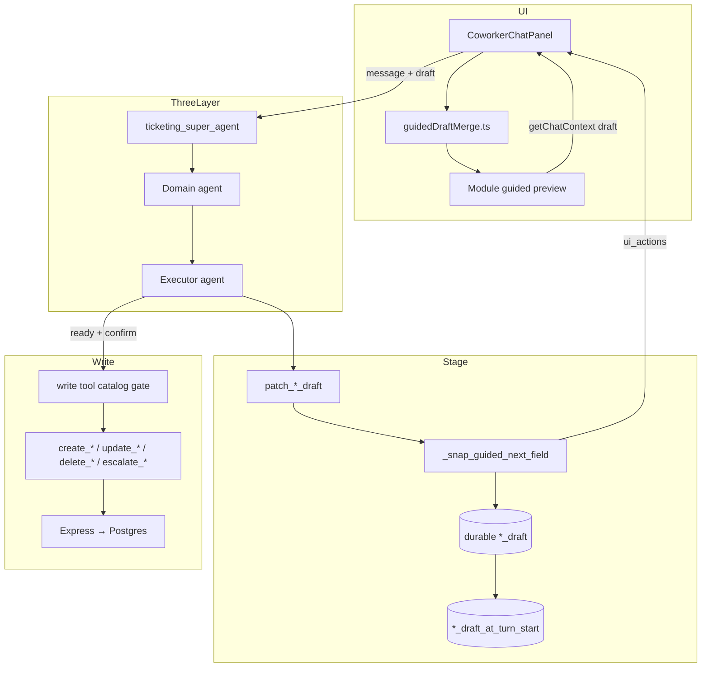

# Guided collect flow plan (Three-Layer MAS)

End-to-end plan to match **Contact Center** guided-create quality — field collection, mid-flow corrections, right-panel preview sync, and reliable patch/write tool calls — across **all Ticketing guided modules**, while keeping the frozen **Super → Domain → Executor** architecture.

> **Audit note (2026-09-10):** Compared against Contact Center (`stage_contact_draft`, `_snap_create_next_field`, `skippedFields`, `ready`, turn-start snapshot, write tool gating). Adapted for Ticketing’s three-layer stack and `patch_*_draft` / agent-turn envelope (not SSE).

Companion docs:

- [architecture-freeze.md](./architecture-freeze.md) — decision boundaries
- [mas-agents-guide.md](./mas-agents-guide.md) — agent layers overview
- [create-team-chat-flow.md](./create-team-chat-flow.md) — example per-module flow doc

---

## Contact Center reference audit — corrections applied

| Topic | Original plan assumption | Contact Center reality | Correction for Ticketing |
|-------|------------------------|------------------------|--------------------------|
| **Field pointer** | `awaiting` only | `nextField` + `nextQuestion` + `ready` | Keep `awaiting` in UI/tools; add **`ready`** when sequence complete |
| **Skip optional fields** | `skippedFields` “optional future” | Fully implemented | **Required** for workflows with optional slots |
| **Correction model** | Two-step: `patch({ awaiting })` then value | Often single-turn re-stage with cumulative merge | Keep `_retarget_instruction_valued_patch` as **MCP hard guard** |
| **Utterance absorb** | Aligned with CC | **Not in CC** | Ticketing-only safety net when LLM skips patch |
| **Memory keys** | `*_draft` only | `contact_draft_at_turn_start` for write guards | Add **`_*_draft_at_turn_start`** per active module |
| **Server wins pointer** | Server `awaiting` wins | `_snap_create_next_field` overrides bad LLM pointer | Never derive step from empty RH fields |
| **Write tool gating** | Implied by `missing_fields()` | Write tools hidden until `ready=true` | Gate write tools in executor catalog until complete + confirm |
| **Draft repair** | Phase 2.1 safety net | Router `_repair_missing_draft` | Synthesize `ui_action` if collect turn ends without patch |
| **Transport** | `ui_actions` + `patch` | SSE `contact_draft` | Same **semantic contract**, different transport |
| **Prompt layers** | Skill + semantics block | Global + surface + agent + skill + live draft injection | Map all five layers (see § Prompt stack) |
| **Post-write state** | `done: true` | `persistedContactId`; preview cleared; navigate | Emit persisted id; clear guided state |
| **Update write guard** | Not explicit | Update requires preview **ready at turn start** | Same rule for catalog/ticket PATCH flows |

---

## Goal (all guided modules)

| Behavior | Target |
|----------|--------|
| Collect | Schema order; LLM calls `patch_*_draft` with real values only |
| Correct | Instruction → `patch_*_draft({ awaiting })` only; value on next turn (MCP guard + LLM) |
| Right panel | Updates every collect/correction turn from `ui_actions` + `patch` |
| Write | `missing_fields()` empty + **`ready=true`** + Skill confirm/disposition |
| Routing | Super continues live pin for collect + in-memory draft corrections |
| Cross-handoff | Ticket ↔ customer park/resume preserves both drafts |

---

## Three-layer architecture (unchanged)

```text
User → Super (route / continue / park)
     → Domain (delegate_to_executor + Skill + task)
     → Executor (patch_*_draft + authorized writes)
     → Express → Postgres
     → ui_actions + patch → RH panel (same turn)
```

Contact Center uses flat surface→agent entry; **Ticketing keeps Super → Domain → Executor.** This plan hardens staging, snap, RH sync, and write gates inside the Executor layer only.

---

## Cross-verification: CRUD coverage

| Tier | Scope | After plan completes |
|------|--------|----------------------|
| **A — patch-guided** | 7 creates, team-members update, catalog update/delete, escalate, reassign | Collect, correction, RH sync same turn; write once |
| **B — persisted CRUD** | KB/macro/team/ticket update, publish, resolve/reopen, category manage, import | Unchanged pattern (list/get → write); no regression; shared confirm guards |
| **C — read / proactive** | Search, analytics, dashboard, automation rules, notifications, post-insert triage | Out of scope; not RH draft flows |

**Tier A** is what “all guided modules work fine” means for chat collect + RH preview. **Tier B** already works without a RH wizard. **Tier C** is intentionally excluded.

Skills with `patch_*_draft` in `local-controls` (Tier A core): ticket-create, customer-create, knowledge-article-create, macro-create, team-create, priority-create, status-create, team-members-update, ticket-escalate, ticket-reassign.

**Honest summary:** Yes — three-layer routing stays; Tier A gets Contact Center-quality collect/correct/RH sync; Tier B/C are not regressed. Wave 5 manual matrix validates every Tier A row: collect → correct → confirm → write → RH navigate.

---

## What stays frozen (do not change)

| Layer | Owns |
|-------|------|
| **Super** (`ticketing_super_agent`) | Route / continue / park / resume |
| **Domain** | `delegate_to_executor` with Skill + task |
| **Executor** | LLM meaning; `patch_*_draft` + writes; grounded replies |
| **Express / Postgres** | Persistence on successful writes only |
| **React** | `POST /api/coworker/agent-turn` → chat + RH preview |

**Do not add:** flat surface→agent routing, keyword/regex intent on query path, LangGraph chat graph as meaning engine, LLM writes skipping Express RBAC.

---

## Complete module inventory

Every row below must obey the same **stage → preview → confirm → write** contract. Grouped by flow type.

### A. Create flows (in-memory draft → write)

| Module | Task id | Skill | Executor domain | Patch tool | Write tool(s) | Schema | Collect order | UI `type` | RH panel / view |
|--------|---------|-------|-----------------|------------|---------------|--------|---------------|-----------|-----------------|
| **Ticket** | `ticket.create` | `ticket-create` | intake / ticket | `patch_ticket_draft` | `create_ticket` | `create_ticket` | name → contact → **verify** → issue → confirm | `create_ticket` | `CreateTicketView.tsx` |
| **Customer** | `customer.create` | `customer-create` | catalog | `patch_customer_draft` | `create_customer` | `create_customer` | name → email → phone → confirm | `create_customer` | `CustomersView.tsx` |
| **KB article** | `knowledge.article.create` | `knowledge-article-create` | catalog | `patch_kb_draft` | `draft_kb_article` / `create_kb_article` | `create_kb` | title → category → body → draft/publish → write | `create_kb` | `KnowledgeBaseView.tsx` |
| **Macro** | `macro.create` | `macro-create` | catalog | `patch_macro_draft` | `create_macro` | `create_macro` | title → body → confirm | `create_macro` | `MacrosView.tsx` |
| **Team** | `team.create` | `team-create` | catalog | `patch_team_draft` | `create_queue` | `create_team` | name → description → members → confirm | `create_team` | `AgentQueuesView.tsx` |
| **Priority** | `priority.create` | `priority-create` | catalog | `patch_priority_draft` | `create_priority` | `create_priority` | name → hours → confirm | `create_priority` | `PrioritiesView.tsx` |
| **Status** | `status.create` | `status-create` | catalog | `patch_status_draft` | `create_status` | `create_status` | name → confirm | `create_status` | `PrioritiesView.tsx` |

**KB notes:** `publication_intent` (`draft` \| `publish`) is required before write. Never use `publish_kb_article` for in-memory-only drafts.

**Ticket notes:** No chat enrich before file; `verify_ticket_customer` before issue. CDP miss → park ticket, run `customer.create`, resume ticket.

**Customer notes:** Schema lists name + email + phone; product may treat phone as skippable when email present — use `skippedFields` + snap rule (align with CC “at least one contact path”).

### B. Update flows (persisted row + patch draft)

| Module | Task id | Skill | Patch tool | Write tool | UI `type` | RH panel |
|--------|---------|-------|------------|------------|-----------|----------|
| **Priority update** | `priority.update` | `priority-update` | `patch_priority_draft` | `update_priority` | `update_priority` / `create_priority`* | `PrioritiesView.tsx` |
| **Status update** | `status.update` | `status-update` | `patch_status_draft` | `update_status` | `update_status` / `create_status`* | `PrioritiesView.tsx` |
| **Macro update** | `macro.update` | `macro-update` | `patch_macro_draft` | `update_macro` | navigate + confirm | `MacrosView.tsx` |
| **Team update** | `team.update` | `team-update` | `patch_team_draft` | `update_queue` | `update_team` | `AgentQueuesView.tsx` |
| **KB article update** | `knowledge.article.update` | `knowledge-article-update` | `patch_kb_draft`† | `update_kb` | `open_kb` + form | `KnowledgeBaseView.tsx` |
| **Add members** | `team.members.update` | `team-members-update` | `patch_team_draft` | `update_queue` (`add_members`) | `update_team` | `AgentQueuesView.tsx` |

\* Catalog table stays visible; patch uses `catalog_update` mode (no create panel for delete_confirm).  
† In-memory draft correction stays on **create** Skill; persisted id required for **update** Skill.

**Update write guard (CC parity):** PATCH/write only if draft was **`ready` at turn start** (`*_draft_at_turn_start`).

### C. Delete flows (confirm panel)

| Module | Task id | Skill | Patch tool | Write tool | UI `type` | RH panel |
|--------|---------|-------|------------|------------|-----------|----------|
| **Priority delete** | `priority.delete` | `priority-delete` | `patch_priority_draft` | `delete_priority` | `delete_priority` | `GuidedDeletePreview` |
| **Status delete** | `status.delete` | `status-delete` | `patch_status_draft` | `delete_status` | `delete_status` | `GuidedDeletePreview` |
| **Team delete** | `team.delete` | `team-delete` | `patch_team_draft` | `delete_queue` | `delete_team` | `GuidedDeletePreview` |
| **Macro delete** | `macro.delete` | `macro-delete` | `patch_macro_draft` | `delete_macro` | (refresh) | — |

Delete flows use `awaiting=delete_confirm`; do not collect create fields (e.g. resolution hours on priority delete).

### D. Ticket action flows (patch draft, no create panel)

| Module | Task id | Skill | Patch tool | Write tool | Schema | Collect order |
|--------|---------|-------|------------|------------|--------|---------------|
| **Escalate** | `ticket.escalate` | `ticket-escalate` | `patch_escalate_draft` | `escalate_ticket` | `escalate` | ticket_number → assignee → note? → confirm |
| **Reassign** | `ticket.reassign` | `ticket-reassign` | `patch_reassign_draft` | `update_ticket` / role-specific | `reassign_ticket` | ticket → role → person → note? → confirm |

**UI:** No dedicated RH guided preview today; actions apply via ticket context / list refresh. Plan: optional `GuidedTicketActionPreview` or inline ticket detail panel.

### E. Related (not full `patch_*_draft` create loop)

| Flow | Skill | Staging | Notes |
|------|-------|---------|-------|
| **KB category manage** | `knowledge-category-manage` | `manage_kb_category` | Separate schema `manage_kb_category`; do not mix with `create_kb` |
| **KB publish existing** | `knowledge-article-publish` | list/get + `publish_kb_article` | Persisted Draft row only |
| **Customer verify** | `customer-verify` | ticket draft + verify tool | Sub-step of ticket create, not standalone RH create |

### F. Cross-module handoffs (must preserve drafts)

| Trigger | Behavior |
|---------|----------|
| Ticket create + CDP miss | Park `ticket_draft`; Domain → `customer.create`; on success restore ticket + `offer_continue_ticket_after_customer` |
| Side quest during guided create | Executor `return_to_super` park; Super routes; resume without re-asking filled fields |
| In-memory correction vs persisted update | Unfinished `kb_draft` without id → stay `knowledge-article-create`; with id from list/get → `knowledge-article-update` |

---

## Contact Center mapping → Ticketing

| Contact Center | Ticketing equivalent |
|----------------|---------------------|
| `stage_contact_draft` | `patch_*_draft` |
| `create_contact` | Module write tools (see inventory) |
| SSE `contact_draft` | Agent-turn `ui_actions` + `patch` + `data.*_draft` |
| `_snap_create_next_field` | `_snap_guided_next_field` in `_execute_local_ui_tool` |
| `nextField` / `ready` | `awaiting` / `ready` |
| `skippedFields` | `skippedFields` on all schemas with optional slots |
| `contact_draft_at_turn_start` | `{module}_draft_at_turn_start` |
| Tool catalog gating | Hide writes until `ready=true` + confirm |
| `_repair_missing_draft` | Agent-turn draft synthesis (Phase 2.1) |
| STAGED DRAFT prompt block | `_GUIDED_PATCH_SEMANTICS_BLOCK` + live draft JSON |
| `_absorb_guided_field_utterance` | **Ticketing-only** fallback |

---

## Prompt stack (all executors)

| Layer | Ticketing location |
|-------|-------------------|
| Global coworker rules | Harness base + `_CHAT_REPLY_STYLE_BLOCK` |
| Surface / module rules | `pageBridge.surface` / module in executor context |
| Agent rules | Executor `agent.md` |
| Skill procedure | `app/skills/<skill>/SKILL.md` |
| Live draft injection | `## Live guided draft` + `_GUIDED_PATCH_SEMANTICS_BLOCK` |

**Copy in spirit from CC:**

- Staging is not a save
- Preserve cumulative fields + skips; never restart from empty
- One focused question per missing field
- New field value ≠ write confirmation
- After persisted id returned, task finished — no duplicate write

---

## Memory model (all modules)

### Durable draft shape

```text
{module}_draft = {
  mode: "create" | "update" | "delete" | "escalate" | "reassign",
  ...schema fields...,              // cumulative
  skippedFields: [ ... ],           // optional slots explicitly skipped
  awaiting: "field" | "confirm" | "delete_confirm" | null,
  ready: false | true,
  persistedId: null | "...",
  _intent_start_text: "...",       // create-start utterance (internal; stripped from UI)
}
```

### Turn-start snapshot

At agent-turn open: `{module}_draft_at_turn_start = deepcopy({module}_draft)`.

- **Create writes:** `ready=true` + semantic confirm same turn
- **Update writes:** preview was ready **before** this turn’s new values

### Client roundtrip

- `getChatContext().draft` / `resolve_client_form_drafts()` — module-scoped hydrate only
- Merge client **values**; server owns `awaiting`, `ready`, `skippedFields`

---

## Target contract (every module in § Inventory)

```text
Collect turn:
  User gives value      → patch_*_draft({ field: value }) + cumulative merge
  User asks to change   → patch_*_draft({ awaiting: "field" }) ONLY  [MCP guard]
  User skips optional   → patch_*_draft({ skippedFields: [...] }) or explicit skip slot

Every successful patch:
  → durable *_draft updated (merge)
  → ui_action { type: create_*|update_*|delete_*|..., fields, awaiting, ready, skippedFields? }
  → right panel refreshes

Write turn:
  → missing_fields() empty AND ready === true AND confirm/disposition
  → write tool once (gated in catalog)
  → persistedId; ui_action done; clear guided UI; navigate/open/refresh
```

---

## End-to-end pipeline



---

## Right-panel wiring (all modules)

### Transport path (same for every module)

```text
patch_*_draft success
  → _execute_local_ui_tool appends ui_action
  → agent-turn returns ui_actions + patch + data.*_draft
  → CoworkerChatPanel: applyAgentTurn()
  → onChatActions / onDraftPatch
  → module view merges into RH state
  → getChatContext sends draft on next message
```

### UI integration patterns (today → target)

| View | Draft roundtrip today | Target |
|------|----------------------|--------|
| `CreateTicketView.tsx` | `getChatContext` + `onDraftPatch` on embedded split | + `guidedDraftMerge` |
| `KnowledgeBaseView.tsx` | `getChatContext` + `onDraftPatch` on embedded split | + `guidedDraftMerge` |
| `CustomersView.tsx` | `pageBridge` + `applyCustomerChatActions` | Fix `awaiting` derivation; merge helper |
| `TicketsView.tsx` | `pageBridge` (focus only) | Escalate/reassign draft if preview added |
| `AgentQueuesView.tsx` | `App.tsx` seed + local `applyTeamDraftFromActions` | `pageBridge` + merge helper |
| `MacrosView.tsx` | `App.tsx` seed + local handlers | `pageBridge` + merge helper |
| `PrioritiesView.tsx` | `App.tsx` seed + delete preview | `pageBridge` + merge helper |

**Gap to close:** Not every module registers `pageBridge`; some rely only on `App.tsx` `*CreateSeed`. **All split modules** should register `getChatContext` / `onDraftPatch` / `onChatActions` consistently.

### Key files

| Layer | File |
|-------|------|
| Patch execute | `ai-agents/app/agents/ticketing_coworker.py` — `_DRAFT_TOOL_SPEC`, `_execute_local_ui_tool`, `_ACTIVE_WORKFLOW_DRAFT`, `_GUIDED_TASK_DRAFT` |
| Schemas | `ai-agents/app/workflow_schemas.py` — all `CREATE_*` / `ESCALATE` / `REASSIGN` / `MANAGE_KB_CATEGORY` |
| Tool defs | `ai-agents/app/mcp/catalog.py` |
| Agent-turn | `ai-agents/app/agent_turn.py` — `resolve_client_form_drafts`, `DRAFT_DATA_KEYS` |
| UI normalize | `ui-frontend/src/components/coworker/coworkerActions.ts` — `applyAgentTurn` |
| Chat | `ui-frontend/src/components/coworker/CoworkerChatPanel.tsx` |
| Router | `ui-frontend/src/App.tsx` — `handleCoworkerChatActions` |
| Shared merge (planned) | `ui-frontend/src/components/coworker/guidedDraftMerge.ts` |
| Previews | `GuidedTicketPreview`, `GuidedTeamPreview`, `GuidedDeletePreview`, module forms |

---

## Phase 1 — Backend: shared stage pipeline (all patch tools)

**Owner:** `ticketing_coworker.py`, `workflow_schemas.py`

### 1.1 Shared patch semantics (all 9 patch tools)

Apply to: ticket, customer, kb, macro, team, priority, status, escalate, reassign.

1. `_retarget_instruction_valued_patch` — instruction as value → `awaiting` only
2. `_reject_incompatible_slot_values` — schema-after-LLM
3. `looks_like_field_edit_instruction` — titles, names, body, long_text
4. **Cumulative merge** — never drop prior fields/skips on partial patch
5. **`ready` computation** — `ready=true` only when sequence complete per schema

### 1.2 `_snap_guided_next_field` (per workflow)

| Workflow | Snap rules |
|----------|------------|
| **create_kb** | title → category → body → publication_intent; no invented category |
| **create_customer** | name → email → phone; email\|phone rule; `skippedFields` for optional skip |
| **create_ticket** | name → contact → verify → issue; no enrich pre-verify |
| **create_macro** | title → body |
| **create_team** | name → description → members (roster-validated) |
| **create_priority** | name → hours |
| **create_status** | name only |
| **add_team_members** | team (from list/get) → members |
| **escalate** | ticket_number (from list/focus) → assignee |
| **reassign** | ticket → target_role → person |
| **catalog update** | id required; no create collect on update/delete pick |
| **delete_*** | `delete_confirm` only; no create fields |

On violation: `SEQUENCE_VIOLATION` + `guidance` + `{ awaiting, ready, draft }`.

**Override:** bad LLM `awaiting` → snap replaces with first open slot.

### 1.3 Every patch emits UI

Always refresh `ui_actions` with `_public_guided_draft(draft)` + `awaiting` + `ready` + `skippedFields` (including awaiting-only corrections).

### 1.4 Absorb *(Ticketing-only fallback)*

`_absorb_guided_field_utterance`: active slot only; no correction phrases; mirror TaskState. Create Skills: on. Update/delete Skills: `skip_absorb`.

### 1.5 Write tool catalog gating

| State | Write tools visible |
|-------|---------------------|
| Collecting (`ready=false`) | None |
| Ready, no confirm | None |
| Ready + confirm | Authorized write once |
| After `persistedId` | Read/list only |

Per-module write tools — see § Complete module inventory.

### 1.6 Turn-start snapshot

Copy live draft to `{module}_draft_at_turn_start` at agent-turn open.

### 1.7 Declarations (every Skill in inventory)

| File | Scope |
|------|--------|
| `mcp/catalog.py` | All 9 `patch_*_draft` descriptions |
| `agent.md` | Each executor in inventory |
| `SKILL.md` | Each create/update/delete/action skill |
| `_GUIDED_PATCH_SEMANTICS_BLOCK` | All harness executors |

### 1.8 Tests (`test_tool_loop.py`)

**Per module group** (create / update / delete / escalate / reassign):

- Instruction phrase does not overwrite draft
- Awaiting-only retarget preserves fields
- Sequence snap blocks skip-ahead
- `ready` false until complete
- `skippedFields` merge (where applicable)
- Write gated when `ready=false`
- Update rejected when not ready at turn start
- Patch payload drives `ui_actions`
- Cross-handoff: ticket park → customer create → resume ticket

---

## Phase 2 — Agent-turn envelope

**Owner:** `agent_turn.py`, `ui-backend/server.ts`, `coworkerActions.ts`

### 2.1 Always return draft on collect turns

Include: non-done `ui_action`, `patch`, `data.*_draft`, **`ready`**, **`awaiting`**, **`skippedFields`**.

**Repair:** if LLM skips patch but absorb/draft changed → synthesize `ui_action` (CC `_repair_missing_draft`).

### 2.2 Session roundtrip

Module-scoped hydrate; server `awaiting` + `ready` authoritative.

### 2.3 Post-write envelope

`persistedId`, `done: true`, clear guided client state, `open_*` / `refresh_*`.

---

## Phase 3 — Frontend: unified merge (all module views)

### 3.1 `guidedDraftMerge.ts`

One helper for **all** `create_*`, `update_*`, `delete_*`, and ticket-action types:

- Partial merge; preserve on retarget
- Field aliases per module
- Step from server `awaiting` (not empty-field heuristics)
- `ready` banner; `skippedFields` display
- `done`, `open_*`, `refresh_*`, `persistedId`

### 3.2 Page bridge (every split module)

Register on: Customers, KB, Ticket create, Teams, Macros, Priorities, (Tickets list for escalate/reassign).

### 3.3 App.tsx seeds

Seeds for first navigation only; thereafter follow server draft.

### 3.4 RH UX checklist (all create/update panels)

- Highlight `awaiting`
- Show collected + skipped fields
- Progress from collected + skipped vs total
- On retarget: old value visible until replaced
- On done: close guided; open entity

---

## Phase 4 — Three-layer routing (all modules)

| Case | Super | Domain | Executor |
|------|-------|--------|----------|
| Field answer on live pin | `continue_active_task` | same Skill | `patch_*_draft` |
| In-memory draft correction | `continue_active_task` | same create Skill | `patch_*_draft({ awaiting })` |
| Persisted row edit | `route_to_domain` | update/delete Skill | list/get + write |
| Different module mid-flow | park | route | `return_to_super` |

Super never collects; Domain never collects; Executor never routes.

---

## Phase 5 — Rollout (all modules)

### Wave 1 — Shared infrastructure

- [ ] `ready`, `skippedFields`, `*_draft_at_turn_start` on draft schema
- [ ] `_snap_guided_next_field` framework + `SEQUENCE_VIOLATION`
- [ ] Write tool gating helper
- [ ] Agent-turn repair + full draft in response
- [ ] `guidedDraftMerge.ts` skeleton

### Wave 2 — Create flows (high traffic)

| Module | Snap + tests | Skill/agent.md | UI merge + pageBridge |
|--------|--------------|----------------|------------------------|
| KB create | | | |
| Customer create | | | |
| Ticket create | | | |
| Macro create | | | |
| Team create | | | |
| Priority create | | | |
| Status create | | | |

### Wave 3 — Update / delete / actions

| Module | Notes |
|--------|-------|
| Priority/status update | Turn-start ready guard |
| Priority/status/macro/team delete | `delete_confirm` panel |
| Team members update | `update_team` UI; roster exact match |
| Macro/team/KB update | Persisted id from list/get |
| Escalate / reassign | Snap + optional RH preview |
| KB category manage | Separate from create_kb |
| KB publish existing | No in-memory draft path |

### Wave 4 — Cross-handoffs & regression

- [ ] Ticket ↔ customer park/resume
- [ ] Super revalidation before park (draft correction)
- [ ] Full manual matrix: every module × collect → correct → write

---

## Phase 6 — Definition of done (all modules)

1. Collect: one patch per field turn → RH updates same turn  
2. Multi-field utterance: merge valid values; ask first missing in schema order  
3. Correction: instruction → field unchanged, `awaiting` retarget  
4. Correction value: one field updated; others preserved  
5. Skips: optional fields skippable where schema allows; `skippedFields` tracked  
6. No skip-ahead: `ready` false until sequence complete  
7. Write: gated until `ready` + confirm; single write  
8. Update guard: ready at turn start for PATCH  
9. Post-write: `persistedId`; no duplicate write; guided cleared  
10. Routing: Super/Domain/Executor boundaries respected  
11. **Every module in § Inventory** passes manual E2E + targeted pytest  

---

## Suggested timeline

| Week | Work |
|------|------|
| 1 | Shared backend: ready, skippedFields, snap framework, KB + customer |
| 2 | Ticket, macro, team, priority/status create snaps; write gating; agent-turn repair |
| 3 | `guidedDraftMerge.ts`; wire all create views + pageBridge |
| 4 | Update/delete/action modules; escalate/reassign |
| 5 | Cross-handoffs; full regression matrix |

---

## Explicit non-goals

- Flat surface→agent routing
- Regex/keyword intent for corrections or paging
- UI updates without `patch_*_draft` (or repair synthesis)
- Frontend inventing draft/`awaiting` when API empty
- Parallel `stage_*` tools (extend `patch_*_draft`)
- Claiming absorb exists in Contact Center

---

## Implementation entry point

**Wave 1 + KB create** — proves CC behavior for one module, then replicate row-by-row through § Complete module inventory.

**First concrete tasks:**

1. Add `ready`, `skippedFields`, `kb_draft_at_turn_start` to draft schema  
2. `_snap_guided_next_field` for `create_kb`  
3. Gate `draft_kb_article` / `create_kb_article` until `ready=true`  
4. Full draft on every patch in agent-turn  
5. KB E2E: collect → retarget correction → category → body → draft/publish → write  
6. Repeat checklist for next row in inventory table  
