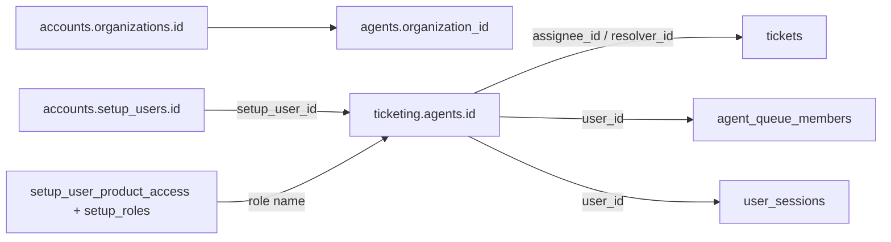

# Accounts ↔ Ticketing agents & ticket scope filters

**Audience:** anyone computing ticket counts/lists (UI, APIs, coworker chat, analytics).  
**Rule:** this pattern is **generic for every organization** — only the numeric ids change per org/person.

Related: [ticketing-hub-spoke-ownership.md](./ticketing-hub-spoke-ownership.md), [ticketing-table-catalog.md](./ticketing-table-catalog.md).

---

## 1. Two different user ids (never mix)

| Layer | ID column | Table | What it is |
|-------|-----------|--------|------------|
| **MyAccount (hub)** | `setup_users.id` | `accounts.setup_users` | Real staff identity: login, password, skills, product role |
| **Ticketing (spoke)** | `agents.id` | `ticketing.agents` | Local PK used on tickets, sessions, notes, queue membership |

**Bridge (same for all orgs):**

```text
accounts.setup_users.id  ==  ticketing.agents.setup_user_id
```

**What tickets store:**

```text
tickets.assignee_id   → ticketing.agents.id
tickets.resolver_id   → ticketing.agents.id
tickets.created_by_id → ticketing.agents.id   (when staff-created)
agent_queue_members.user_id → ticketing.agents.id
user_sessions.user_id       → ticketing.agents.id
```

**Wrong:** filter `assignee_id = setup_users.id` (e.g. admin MyAccount `1013`).  
**Right:** resolve MyAccount user → `agents.id`, then filter (e.g. admin Ticketing `1005`).

---

## 2. How mapping works (generic procedure)

Applies to **every** organization:

1. Company exists in **`accounts.organizations`** (`id` = tenant / `organization_id`).
2. Staff exists in **`accounts.setup_users`**.
3. Staff has Ticketing product access in **`accounts.setup_user_product_access`**:
   - `product_id = 'ticketing'`
   - `organization_id` = that company
   - `role_id` → **`accounts.setup_roles`** (`admin` / `agent` / `resolver` / …)
4. Ticketing creates or finds **`ticketing.agents`**:
   - `organization_id` = same as MyAccount org id
   - `setup_user_id` = `setup_users.id`
   - `role` = mirrored product role (spoke copy; MyAccount remains authoritative for identity)
5. Login JWT / session uses **`agents.id`** as the Ticketing user id.
6. All ticket assignment and “assigned to me” filters use **`agents.id`**.



**Resolve helper (conceptual):**

```sql
SELECT ag.id AS ticketing_agent_id
FROM ticketing.agents ag
WHERE ag.organization_id = :org_id
  AND ag.setup_user_id = :accounts_setup_user_id
  AND ag.status = 'Active';
```

---

## 3. Example: organization `1000` (ZIFO)

Illustrative live mapping (ids can change; always join, don’t hardcode):

| Ticketing `agents.id` | MyAccount `setup_user_id` | Role | Person |
|----------------------|---------------------------|------|--------|
| **1005** | **1013** | **admin** | Deva NS |
| 1004 | 1012 | agent | Raghuram M |
| 1000 | 1000 | resolver | Yaswanth MG |
| 1002 | 1010 | resolver | Ashika A |
| 1003 | 1011 | resolver | Sri Annamalai |

So: MyAccount admin user **1013** ↔ Ticketing agent **1005**.

---

## 4. Roles vs scopes

| Role (MyAccount ticketing product / `agents.role`) | Default data scope | Meaning |
|----------------------------------------------------|--------------------|---------|
| `admin` | **org** | Sees whole organization unless they ask for a personal/other slice |
| `viewer` | **org** | Read-only org-wide (same list scope idea as admin) |
| `agent` | **assignee** | Default = tickets where they are L1 assignee |
| `resolver` | **assignee-style** | Default = tickets where they are L2 resolver **or** L1 assignee |
| `customer` / portal | **requester** | Their own cases (customer email / portal contact) |

Code references: `dataScopeForRole` (`ui-backend/src/rbac.ts`), `ticket_data_scope` (`ai-agents/app/rbac.py`).

**Role chooses the default scope.** Intent of the question can narrow or widen within what RBAC allows (see §5–§6).

---

## 5. Always start with organization

Every count/list:

```sql
WHERE organization_id = :org_id   -- logged-in tenant; same as accounts.organizations.id
```

Then add **one** of the filters below. Replace `:me` with the caller’s **`ticketing.agents.id`**.

---

## 6. All common scope filters (calculations / chat / API)

### 6.1 Organization-wide (default for admin / viewer)

**Utterance examples:** “How many tickets are there?”, “Total tickets”, “Org ticket volume”

```sql
WHERE organization_id = :org_id
-- no person filter
```

Optional status slices:

| Intent | Extra filter |
|--------|----------------|
| Open / active | non-terminal statuses (e.g. not `Resolved`) via `ticket_statuses.is_terminal` |
| Resolved / closed | terminal status / `resolved_at IS NOT NULL` |
| Overdue | `status = 'Overdue'` or past `due_at` while open |
| Unassigned (org) | missing L1 and/or L2 (see `UNASSIGNED_SQL` in Express) |

---

### 6.2 Assigned to **me** (personal)

**Utterance examples:** “How many tickets are assigned to me?”, “My tickets”, “My workload”

| Caller role | Filter |
|-------------|--------|
| **Admin** (personal slice) | `assignee_id = :me OR resolver_id = :me` |
| **Agent** | `assignee_id = :me` |
| **Resolver** | `resolver_id = :me OR assignee_id = :me` |

```sql
-- Agent “mine”
WHERE organization_id = :org_id AND assignee_id = :me

-- Resolver “mine”
WHERE organization_id = :org_id
  AND (resolver_id = :me OR assignee_id = :me)

-- Admin “mine” (explicit personal ask; not default org total)
WHERE organization_id = :org_id
  AND (assignee_id = :me OR resolver_id = :me)
```

Also match display-name fallbacks when ids are null (Express):  
`lower(assignee_name) = lower(:my_name)` / `resolver_name` — prefer **id** when present.

---

### 6.3 Assigned to a **named person** (any role that may ask)

**Utterance examples:** “How many tickets does Raghuram have?”, “Tickets for Deva”, “Assigned to Yaswanth”

1. Resolve name/email → **`agents.id`** in this org (via MyAccount name/email join or roster).
2. Filter by that person’s **agent id** (not setup_user_id).

```sql
WHERE organization_id = :org_id
  AND assignee_id = :their_agent_id          -- L1 load
-- or
  AND resolver_id = :their_agent_id          -- L2 load
-- or both if “all tickets they’re on”
  AND (assignee_id = :their_agent_id OR resolver_id = :their_agent_id)
```

**RBAC note:** agents/resolvers may be restricted to assignee/team default in product UI; admins typically can query any person in the org. Chat/metrics should still **resolve to `agents.id`**.

---

### 6.4 By **role class** (all agents / all resolvers / all admins)

**Utterance examples:** “How many tickets are on agents?”, “Resolver queue”

```sql
WHERE organization_id = :org_id
  AND assignee_id IN (
    SELECT id FROM ticketing.agents
    WHERE organization_id = :org_id AND lower(role) = 'agent' AND status = 'Active'
  )
```

Prefer joining live MyAccount role when available (`setup_user_product_access` + `setup_roles`) instead of only `agents.role` if they can diverge.

---

### 6.5 Team / queue scope

**Utterance examples:** “Tickets on my team”, “Bug Solvers backlog”, “Unassigned on my teams”

Membership:

```sql
SELECT queue_id
FROM ticketing.agent_queue_members
WHERE organization_id = :org_id AND user_id = :me   -- agents.id
```

**My teams’ tickets** (team pool + tickets I’m on):

```sql
WHERE organization_id = :org_id
  AND (
    queue_id = ANY(:my_queue_ids)
    OR assignee_id = :me
    OR resolver_id = :me
  )
```

**Named team:**

```sql
WHERE organization_id = :org_id
  AND (
    queue_id = :queue_id
    OR lower(queue_name) = lower(:queue_name)
  )
```

**Unassigned on my teams** (non-admin): unassigned predicate **and** queue in my membership.  
**Unassigned org-wide** (admin/viewer): unassigned predicate only.

---

### 6.6 Created by me / created by person

**Utterance examples:** “Tickets I created”, “Opened by Deva”

```sql
WHERE organization_id = :org_id AND created_by_id = :agent_id
```

(Audit alternative: `audit_events.actor_id = :agent_id AND action = 'ticket.created'`.)

---

### 6.7 Customer / requester scope

**Utterance examples (portal / customer role):** “My tickets”

```sql
WHERE organization_id = :org_id
  AND lower(customer_email) = lower(:my_email)
-- or
  AND customer_id = :contact_profile_id
```

---

### 6.8 Search / inbox module scopes (product list modes)

Express list scopes (`ticketListScopeClause`) — useful when matching UI modules:

| List scope | Who | Filter idea |
|------------|-----|-------------|
| `default` | by role | admin/viewer → org; agent → assignee; resolver → assignee/resolver; customer → requester |
| `org` | admin/viewer (or elevated) | org-wide |
| `assignee` | staff | personal assignee(/resolver) slice |
| `team` | roles with team-inbox | my queues ∪ tickets I’m L1/L2 on |
| `unassigned` | admin → org unassigned; agent → unassigned in my queues | see §6.5 |
| `created` | staff | `created_by_id = me` |
| `search` | admin → org; agent → team-like; others → default role scope | |

---

## 7. Intent matrix (what to return)

Use **role default**, then override when the utterance is explicit.

| Asker | Question intent | Recommended scope |
|-------|-----------------|-------------------|
| **Admin** | “How many tickets are there?” / “overall” / “in the org” | **Org-wide** |
| **Admin** | “Assigned to me” / “my tickets” | **Personal** (`assignee_id` or `resolver_id` = my `agents.id`) |
| **Admin** | “Assigned to \<agent name\>” | That person’s **`agents.id`** as L1 |
| **Admin** | “On resolvers” / “\<resolver name\>’s tickets” | That person’s id as L2 (or L1+L2) |
| **Admin** | “On team X” / “Bug Solvers” | **Queue** filter |
| **Admin** | “Unassigned” | Org unassigned |
| **Agent** | “How many tickets?” (no qualifier) | **My assignee** tickets (not org-wide) |
| **Agent** | “My team’s tickets” / team inbox | **Team** scope |
| **Agent** | “Unassigned on my team” | Unassigned ∩ my queues |
| **Agent** | “Org total” (if product allows) | Only if elevated / admin-only answer; default deny org for agents |
| **Resolver** | “How many tickets?” | **My** resolver ∪ assignee tickets |
| **Resolver** | “My team” | Team scope if module allows |
| **Any staff** | “Tickets I created” | `created_by_id = me` |
| **Customer** | “My tickets” | Requester / `customer_id` |

---

## 8. Checklist for implementers (metrics / chat)

1. Bind **`organization_id`** from the logged-in tenant (MyAccount org id = Ticketing org id).
2. Resolve the speaker (and any named colleague) to **`ticketing.agents.id`** via `setup_user_id` — never use MyAccount id on `assignee_id` / `resolver_id`.
3. Read **role** from MyAccount ticketing product access (mirror on `agents.role` is OK for runtime).
4. Choose scope from **role default + utterance intent** (§7).
5. For teams, use **`agent_queue_members.user_id = agents.id`**.
6. Same procedure for **all organizations** — only ids differ.

---

## 9. Quick SQL snippets (copy-paste)

Assume `:org_id`, `:me` = caller `agents.id`, `:other` = target `agents.id`.

```sql
-- A) Org total (admin default)
SELECT COUNT(*) FROM ticketing.tickets WHERE organization_id = :org_id;

-- B) Admin “mine”
SELECT COUNT(*) FROM ticketing.tickets
WHERE organization_id = :org_id
  AND (assignee_id = :me OR resolver_id = :me);

-- C) Agent “mine”
SELECT COUNT(*) FROM ticketing.tickets
WHERE organization_id = :org_id AND assignee_id = :me;

-- D) Resolver “mine”
SELECT COUNT(*) FROM ticketing.tickets
WHERE organization_id = :org_id
  AND (resolver_id = :me OR assignee_id = :me);

-- E) Named agent’s L1 load
SELECT COUNT(*) FROM ticketing.tickets
WHERE organization_id = :org_id AND assignee_id = :other;

-- F) Named resolver’s L2 load
SELECT COUNT(*) FROM ticketing.tickets
WHERE organization_id = :org_id AND resolver_id = :other;

-- G) Resolve MyAccount user → agent id
SELECT id FROM ticketing.agents
WHERE organization_id = :org_id AND setup_user_id = :setup_user_id;
```

---

## 10. Anti-patterns

| Don’t | Do |
|-------|----|
| `assignee_id = setup_users.id` | `assignee_id = agents.id` |
| Assume admin MyAccount id equals Ticketing id | Always join `setup_user_id` |
| Give agents org-wide counts by default | Default agent scope = assignee |
| Filter teams by MyAccount user id | Filter `agent_queue_members.user_id` with `agents.id` |
| Hardcode org `1000` / agent `1005` in product logic | Parameterize org + resolve mapping |

---

## 11. Source of truth summary

| Concern | Source |
|---------|--------|
| Company / tenant id | `accounts.organizations.id` (= `tickets.organization_id`) |
| Staff login identity | `accounts.setup_users` |
| Ticketing product role | `setup_user_product_access` + `setup_roles` |
| Ticket assignee / resolver FK | `ticketing.agents.id` |
| Team membership | `ticketing.agent_queue_members.user_id` → `agents.id` |
| Default list scope by role | `dataScopeForRole` / `ticket_data_scope` |
