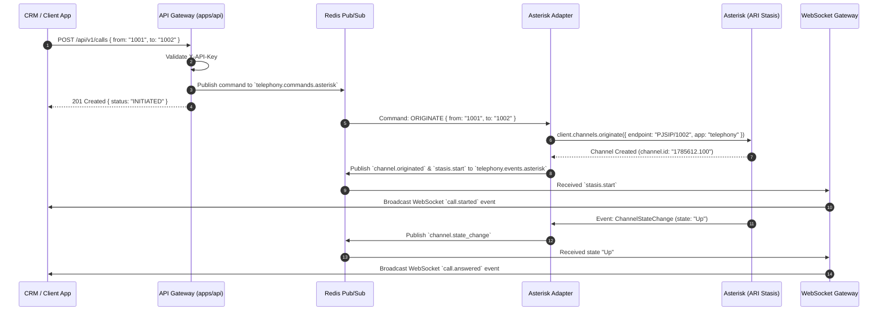

# Telephony Platform V1 - Microservices Architecture Guide

## 1. Architecture Overview

The Telephony Platform decouples core PBX operations (Asterisk ARI/AMI) from consumer applications (CRM, Contact Center, AI Voice). Asterisk is completely encapsulated behind the API Gateway and Redis Event Bus.

```
                        ┌──────────────────────────────────────────┐
                        │          CONSUMING APPLICATIONS          │
                        │  (CRM / Contact Center / AI Voice / UI)  │
                        └────────────────────┬─────────────────────┘
                                             │
                       HTTP REST (X-API-Key) │ Socket.IO / Webhooks
                                             ▼
                        ┌──────────────────────────────────────────┐
                        │             API GATEWAY                  │
                        │          (`apps/api`: NestJS)            │
                        └────────────────────┬─────────────────────┘
                                             │
                 Redis Pub/Sub               │               Redis Pub/Sub
     `telephony.commands.asterisk`           │       `telephony.events.asterisk`
                        │                    │                     ▲
                        ▼                    │                     │
┌─────────────────────────────────────────┐  │  ┌─────────────────────────────────────────┐
│            ASTERISK ADAPTER             │  │  │            TELEPHONY SERVICES           │
│    (`adapters/asterisk-adapter`)        │  │  │  • Call Service                         │
│  • Stasis Engine Connection             │  │  │  • Agent Service                        │
│  • ARI Channels, Bridges, Recordings    │  │  │  • Queue Service                        │
│  • AMI Socket Peer Status Monitor       │  │  │  • Number Service                       │
└────────────────────┬────────────────────┘  │  │  • Recording Service                    │
                     │                       │  │  • Webhook Service                      │
                     │ ARI (8088) / AMI(5038)│  └─────────────────────────────────────────┘
                     ▼                       │
┌─────────────────────────────────────────┐  │
│             ASTERISK PBX                │  │
│         (PJSIP, Stasis App)             │──┘
└─────────────────────────────────────────┘
```

---

## 2. Service Inventory

| Microservice | Path | Responsibility | Communication |
|---|---|---|---|
| **API Gateway** | `apps/api` | REST routes, OpenAPI/Swagger docs, WebSocket event streaming (`EventsGateway`), `X-API-Key` guard | HTTP / WebSocket |
| **Asterisk Adapter** | `adapters/asterisk-adapter` | Connects directly to Asterisk via ARI (`ari-client`) and AMI (`asterisk-ami`). Translates commands → ARI calls and ARI events → Redis | Redis Pub/Sub / ARI / AMI |
| **Call Service** | `services/call-service` | Call State Machine (INITIATED → RINGING → ANSWERED → ON_HOLD → COMPLETED). Updates Prisma DB. | Redis Pub/Sub / Prisma |
| **Agent Service** | `services/agent-service` | Agent CRUD, login/logout presence, queue detachment on logout, status broadcasts | Redis Pub/Sub / Prisma |
| **Queue Service** | `services/queue-service` | ACD queue creation, member assignments, strategy routing (`ringall`, `random`, `leastrecent`), queue metrics | Redis Pub/Sub / Prisma |
| **Number Service** | `services/number-service` | DID number provisioning, provider mapping, inbound DID routing, caller ID resolution | Prisma |
| **Recording Service** | `services/recording-service` | Saves audio recording metadata, links recordings to `CallHistory` | Prisma |
| **Webhook Service** | `services/webhook-service` | Subscribes to event bus, signs payloads with HMAC-SHA256, executes retry delivery to registered webhook URLs | Redis Pub/Sub / HTTP |
| **Admin UI** | `apps/admin-ui` | Operational web dashboard built with React + Vite + Vanilla CSS | HTTP / WebSocket |

---

## 3. Redis Pub/Sub Bus Channels

| Channel | Publisher | Subscriber(s) | Description |
|---|---|---|---|
| `telephony.commands.asterisk` | API Gateway / Call Service | Asterisk Adapter | Dispatch commands (`ORIGINATE`, `HANGUP`, `HOLD`, `RESUME`, `MUTE`, `UNMUTE`, `TRANSFER`, `RECORD`, `STOP_RECORD`, `CONFERENCE`) |
| `telephony.events.asterisk` | Asterisk Adapter | Call Service, EventsGateway, Webhook Service | Raw & normalized PBX events (`stasis.start`, `channel.state_change`, `stasis.end`, `channel.dtmf`, `channel.originated`, `recording.finished`) |
| `telephony.events.agent` | Agent Service | EventsGateway, Webhook Service | Agent lifecycle events (`agent.login`, `agent.logout`, `agent.status_change`) |
| `telephony.events.queue` | Queue Service | EventsGateway, Webhook Service | ACD queue updates (`queue.member_added`, `queue.member_removed`) |

---

## 4. End-to-End Call Originate Sequence


