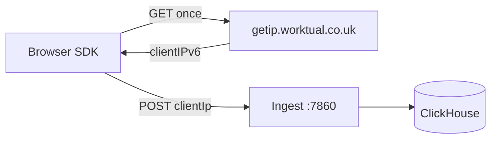

# Client IP via getip.worktual.co.uk

How Worktual resolves **visitor IP** and **geo location** (country, city) for the dashboard.

## Flow

```text
Visitor browser
  → GET https://getip.worktual.co.uk/  (once per session, cached in sessionStorage)
  → SDK includes clientIp on events_v3 / replay_chunk_v1 payloads
  → Ingest validates clientIp → enrich_geo() → ClickHouse raw_payloads.source_ip + payload._geo
  → Materialized views → dim_sessions → dashboard
```



## SDK configuration

Default in [`sdk/src/core/config.js`](../sdk/src/core/config.js):

```js
fetchClientIp: true,
clientIpUrl: 'https://getip.worktual.co.uk/',
```

Disable for testing:

```js
WorktualAnalytics.init({ domainId: 12345, fetchClientIp: false });
```

## getip service response

```json
{ "clientIPv6": "203.0.113.50", "serverIPv6": "..." }
```

The field name is `clientIPv6` but the value may be IPv4 or IPv6. The SDK normalizes `::ffff:x.x.x.x` to IPv4.

## DNS / infra requirement (CORS)

The browser must be allowed to call getip cross-origin from tracked sites (e.g. `beta.worktual.co.uk`).

Ask infra to enable on `getip.worktual.co.uk`:

```http
Access-Control-Allow-Origin: *
```

(or an explicit list of customer domains)

Without CORS, getip fetch fails silently and payloads may omit `clientIp` (tracking still works; geo will be empty).

## Ingest behavior

- Reads **`clientIp`** from the JSON payload (not connection IP / nginx headers).
- Validates format (IPv4 or IPv6).
- Optional: old SDKs without `clientIp` still accepted; geo fields stay empty.
- Sets `payload._geo.location_source = "client_ip"`.

## Verify in ClickHouse

```sql
SELECT
  source_ip,
  JSONExtractString(payload, 'clientIp') AS client_ip_field,
  JSONExtractString(payload, '_geo', 'country') AS country,
  JSONExtractString(payload, '_geo', 'city') AS city,
  received_at
FROM web_tracking.raw_payloads
ORDER BY received_at DESC
LIMIT 10;
```

Different devices/networks should show **different `source_ip`** values (not `127.0.0.1`).

## No nginx IP headers required

Ingest no longer uses `X-Real-IP`, `X-Forwarded-For`, or `TRUSTED_PROXIES`.
